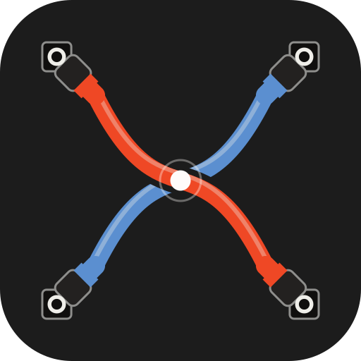
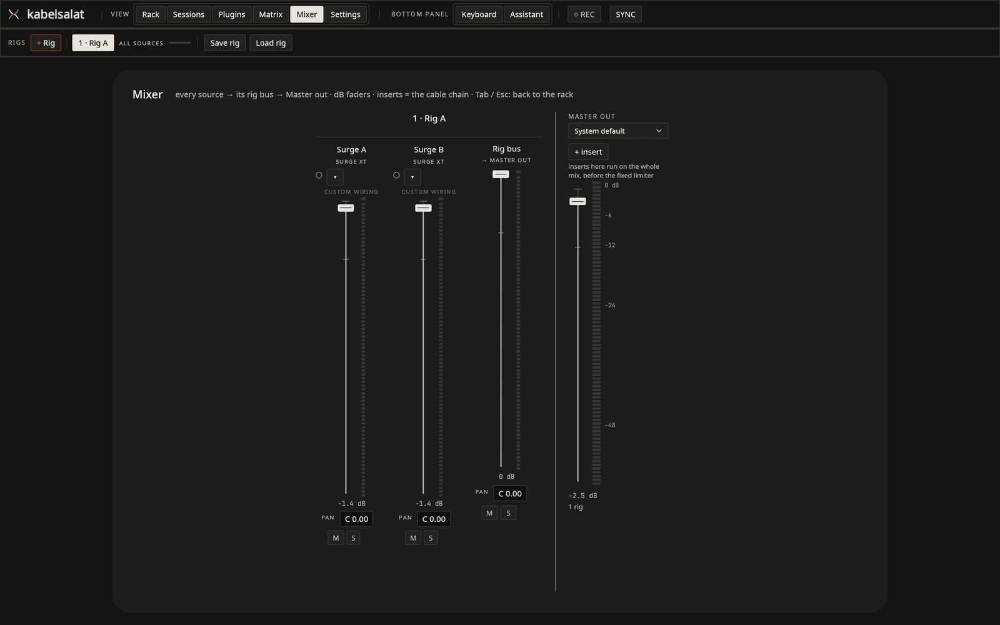

<p align="center">
  
</p>

<h1 align="center">kabelsalat</h1>

<p align="center"><strong>A live rack for Linux: plug in instruments, wire them up, play.</strong></p>

<p align="center">
  <a href="https://github.com/ssalentin/kabelsalat/releases"></a>
  <a href="LICENSE"></a>
  <a href="CONTRIBUTING.md"></a>
  
</p>

<p align="center">
  <a href="#quick-start">Quick start</a> ·
  <a href="#what-you-can-do">What you can do</a> ·
  <a href="docs/GUIDE.md">User guide</a> ·
  <a href="#install">Install</a> ·
  <a href="#roadmap">Roadmap</a>
</p>

<p align="center">
  
</p>

kabelsalat is a host for playing live. Synths and effects sit in a rack,
connected by patch cables you can see and grab, and everything you play goes
straight to the speakers. Several setups ("rigs") sound at once, each from its
own keyboard, and a setlist switches between songs without a gap.

It is for keyboard players, organists, guitarists and anyone who wants a
stage rig on a Linux laptop or a Raspberry Pi: think AUM on the iPad or
MainStage on the Mac. It hosts any CLAP, VST3 or LV2 plugin.

## Quick start

**1. Install.** Download the AppImage for your machine and start it:

```sh
# most PCs and laptops; for ARM (Raspberry Pi 4/5, Asahi) take kabelsalat-aarch64.AppImage
curl -LO https://github.com/ssalentin/kabelsalat/releases/latest/download/kabelsalat-x86_64.AppImage
chmod +x kabelsalat-x86_64.AppImage
./kabelsalat-x86_64.AppImage
```

**2. Get a synth.** The first rig plays [Surge XT](https://surge-synthesizer.github.io/).
If it is not installed, open **Plugins** (key **B**) → **Install** and click
**Install** on its card (or install `surge-xt` from your distribution).

**3. Play.** Your laptop keyboard is a piano: **A S D F G H J K L** are the
white keys, **W E T Y U O P** the black ones, **Z / X** shift the octave. A
USB MIDI keyboard works as soon as you plug it in. **V** shows an on-screen
keyboard.

**4. Look around.** Five keys are enough for the first ten minutes:

| Key | What happens |
|---|---|
| **F5–F7**, **Shift+F5–F7** | Load a starter rig: pipe organ, jazz organ, rock organ, guitar, ambient pad, synth lead |
| **Tab** | Turn the rack around and patch cables on the back |
| **M** | Open the mixer |
| **Q** | Open the left rail with your rigs and saved sessions |
| **?** | Show every shortcut |

Then press **Ctrl+S** to save your session. Something is silent or crackles?
See [Troubleshooting](#troubleshooting).

## What you can do

Each line links to its section in the [user guide](docs/GUIDE.md).

<table>
  <tr>
    <td width="50%"></td>
    <td width="50%"></td>
  </tr>
  <tr>
    <td></td>
    <td></td>
  </tr>
</table>

**Play**
- **An on-screen instrument for every rig:** piano with pedals, organ drawbars
  and Leslie, pipe organ stops, synth wheels and X/Y pad, bass neck, wind
  breath, drum pads. **Shift+V** fills the window with it.
  → [Instruments and the on-screen keyboard](docs/GUIDE.md#instruments-and-the-on-screen-keyboard)
- **Sound within a minute:** the first start finds your output, plays one
  quiet note and opens the keyboard; if the output is missing, the buffer is
  large or realtime rights are, it says so in one sentence and points to the
  Audio Doctor. → [First start](docs/GUIDE.md#first-start)
- **Factory sounds, no plugin needed:** a piano, an electric piano and a drum
  kit are built in, so the first key press sounds even on a bare machine.
  → [Factory sounds](docs/GUIDE.md#factory-sounds)
- **Play your guitar** through amp, cabinet and stomp boxes, with a tuner on
  the input. → [Play your guitar](docs/GUIDE.md#play-your-guitar)

**Build rigs**
- **Patch with real cables** on the back of the rack; they light up when
  signal flows. Lock the rack once it is dialled in.
  → [Patch with real cables](docs/GUIDE.md#patch-with-real-cables)
- **Zoom the rack** with **Ctrl+scroll**, fit it all with **Ctrl+0**, or
  fill the window with one unit (**Ctrl+Shift+F**), on front and back.
  → [Zoom the rack](docs/GUIDE.md#zoom-the-rack)
- **Run up to 32 rigs at once**, each on its own keyboard, with splits,
  layers and velocity ranges. → [Several rigs](docs/GUIDE.md#run-several-rigs-at-once),
  [MIDI matrix](docs/GUIDE.md#route-midi-anywhere)
- **MIDI effects** (transpose, arpeggiator, chord) in front of any instrument.
  → [MIDI effects](docs/GUIDE.md#put-midi-effects-in-front-of-an-instrument)

**Plugins**
- **Browse by what a plugin does**, not by its format: instruments, effects,
  MIDI FX across CLAP, VST3 (native Linux and Windows plugins via yabridge), and
  LV2, with native plugin GUI windows and live bidirectional parameter sync for
  all three formats.
  → [Browse plugins](docs/GUIDE.md#browse-and-install-plugins-by-type),
  [VST3 & plugin GUIs](docs/GUIDE.md#vst3-plugins-and-native-plugin-guis)
- **Keep plugins wherever you like:** add your own CLAP, VST3 and LV2 folders
  under **Settings → Plugins**; they are remembered and rescanned in the
  background. → [Plugin folders](docs/GUIDE.md#search-your-own-plugin-folders)
- **Install 23 tested plugins with one click** (Surge XT, Dexed, Vitalium,
  setBfree, Aeolus, Guitarix, …). → [Catalog](docs/GUIDE.md#install-instruments-from-the-catalog),
  [tested plugins](docs/PLUGINS.md)
- **Out-of-process plugin sandboxing:** each CLAP, VST3 and LV2 plugin runs in
  its own helper process over shared memory — a crash silences only that strip
  and restarts it with its last saved state while every other rig keeps playing.
  → [Plugin crash isolation](docs/GUIDE.md#plugin-crash-isolation)

**Mix**
- **A channel strip per source** with inserts, sends, aux buses and a
  loudness target for the master. → [Mix](docs/GUIDE.md#mix),
  [Sends](docs/GUIDE.md#share-an-effect-with-sends)
- **Other apps in the same mixer** (turn the browser down under your rig),
  and any bus on its own sound card, such as a click to the headphones.
  → [System audio](docs/GUIDE.md#mix-the-other-apps-and-pick-your-sound-card),
  [Bus outputs](docs/GUIDE.md#send-a-bus-to-its-own-sound-card)
- **Stage outputs on one interface:** the master to FOH on 1–2, the click
  and backing track to the in-ears on 3–4, any bus to a wedge, each at its
  own level. → [Stage outputs](docs/GUIDE.md#stage-outputs-foh-in-ears-and-click-on-one-interface)

**Play live**
- **A setlist of songs and parts** that switches without cutting held notes
  or reverb tails. → [Setlist](docs/GUIDE.md#play-a-setlist-without-a-gap),
  [show, set and song levels](docs/GUIDE.md#keep-what-stays-through-the-whole-show)
- **Show mode (F2):** a stage screen readable from two metres, with editing locked
  and upcoming part preview. → [Show mode](docs/GUIDE.md#go-on-stage-with-show-mode)
- **Song notes and chord charts:** attach cues, lyrics or ChordPro lead sheets per
  song and read them in Show mode. → [Song notes & chord charts](docs/GUIDE.md#song-notes-and-chord-charts)
- **Check the show** before the first song: devices, plugins, sound, power, with
  one-click quick-fix links. → [Check show](docs/GUIDE.md#check-the-show-before-the-first-song)
- **Step songs from a foot switch**, attach WAV backing tracks directly to songs,
  record the set or save the last two minutes with **Retro**, and restart by
  itself after a crash. → [Pedals](docs/GUIDE.md#run-the-show-from-a-pedal),
  [Backing tracks](docs/GUIDE.md#play-along-with-a-backing-track),
  [Recording](docs/GUIDE.md#record-your-set),
  [Crash recovery](docs/GUIDE.md#get-back-on-stage-after-a-crash)
- **Survive a bumped cable:** a lost audio interface or MIDI controller comes
  back by itself mid-show, with its routing and bindings, and a notice says so.
  → [Hot-plug](docs/GUIDE.md#unplug-and-replug-mid-show)

**Controllers and tempo**
- **MIDI learn** for every knob, fader and button, and ready-made profiles
  for instruments such as the Nord Electro 2 and the Akai EWI.
  → [Controllers](docs/GUIDE.md#control-knobs-and-the-mixer-from-your-controller)
- **Metronome in any time signature**, and MIDI clock out to drum machines.
  → [Metre](docs/GUIDE.md#count-in-any-metre), [Clock](docs/GUIDE.md#be-the-clock)

**Engine and assistant**
- **See the load per unit** and fix crackles with **Audio Doctor**.
  → [Engine](docs/GUIDE.md#keep-an-eye-on-the-engine),
  [Audio Doctor](docs/GUIDE.md#diagnose-latency-and-xruns-with-audio-doctor)
- **An optional assistant (C)** ("split the keys at C4", "add a reverb") and an
  MCP server for your own AI agent, with **Ctrl+Z** undo for both agent and
  manual edits. Off with one switch.
  → [Assistant](docs/GUIDE.md#ask-the-assistant--or-your-own-ai-agent)

## Install

| Package | For | Notes |
|---|---|---|
| [AppImage x86_64](https://github.com/ssalentin/kabelsalat/releases/latest/download/kabelsalat-x86_64.AppImage) | most PCs and laptops | recommended; finds your system's plugins, realtime audio |
| [AppImage aarch64](https://github.com/ssalentin/kabelsalat/releases/latest/download/kabelsalat-aarch64.AppImage) | Raspberry Pi 4/5, Asahi, Snapdragon | same as above; see [Raspberry Pi & headless rigs](docs/GUIDE.md#raspberry-pi-and-headless-rigs-arm64) |
| Arch / Omarchy | Arch-based systems | `git clone https://github.com/ssalentin/kabelsalat.git && cd kabelsalat/packaging && makepkg -si` (launcher entry and icon) |
| Flatpak, tarball | | on the [releases page](https://github.com/ssalentin/kabelsalat/releases); the Flatpak is sandboxed: no realtime priority yet, and `kabelsalat mcp --attach` cannot reach it |

**You need** Linux with PipeWire (recommended), JACK or ALSA. **Plugins:**
kabelsalat hosts the CLAP, VST3 and LV2 plugins installed on your system; install
more from **Plugins → Install** or from your distribution (Arch: `surge-xt-clap`,
optional `dexed-clap`, `lv2-plugins`). Nightly builds of `main` are on the
[releases page](https://github.com/ssalentin/kabelsalat/releases/tag/nightly).

**From source** (Rust via rustup, `alsa-lib`, `lilv`):

```sh
git clone https://github.com/ssalentin/kabelsalat.git
cd kabelsalat
cargo run --release
```

Packaging details: [docs/PACKAGING.md](docs/PACKAGING.md).

## Troubleshooting

- **No sound:** check the output under **Master out** in the mixer (**M**).
  A unit that says its plugin cannot load needs that plugin installed
  (**Plugins → Install**).
- **Crackles or late notes:** open **Settings → Audio → Audio Doctor**. It
  checks the buffer, realtime priority, CPU governor and USB power saving and
  offers a fix for each. In a terminal: `kabelsalat audio-doctor`.
- **A plugin is missing from the browser:** kabelsalat looks in `~/.clap`,
  `~/.vst3`, `~/.lv2`, `/usr/lib/{clap,vst3,lv2}` and
  `/usr/local/lib/{clap,vst3,lv2}`. Add other folders under **Settings →
  Plugins** (or with `CLAP_PATH`, `VST3_PATH` or `LV2_PATH`). A plugin built
  for another CPU says so instead of loading.
- **Typing Chinese, Japanese or Korean:** start with `KABELSALAT_IME=1`; text
  fields otherwise read the keyboard directly.
- **It crashed:** it restarts by itself and reopens your session. The report
  is in `~/.local/state/kabelsalat/crashes/`, and nothing is sent anywhere.

Still stuck? [Open an issue](https://github.com/ssalentin/kabelsalat/issues/new/choose).

## Roadmap

The goal: **the best open source live performance host for Linux, with
instruments built by the community. Fast, professional, easy to use.**

| Version | Theme |
|---|---|
| **0.3** | **The MainStage for Linux: a whole gig from one setlist (plus VST3 & LV2 GUIs)** |
| 0.4 | Trust it on stage: a plugin crash never stops the show, FOH/IEM/click outputs, hot-plug recovery, Virtual Soundcheck, show sync, macros, factory sounds |
| 0.5 | Instruments by the community: SFZ instruments and an open catalog |
| 0.6 | Runs everywhere, plays everything: packages for your distribution |
| 0.7 | Controllers and remote |
| 0.8 | Practise and create: looper, practice tools, multi-take recording |
| 0.9 | The assistant, on your terms: local models |
| 1.0 | A promise of stability: old sessions keep loading |

The [roadmap to v1.0](https://github.com/ssalentin/kabelsalat/issues/272)
lists the issues behind each version; what changed is in
[CHANGELOG.md](CHANGELOG.md).

## Contributing

Pull requests are welcome. Start with [CONTRIBUTING.md](CONTRIBUTING.md) and
the issues labelled
[`good first issue`](https://github.com/ssalentin/kabelsalat/labels/good%20first%20issue)
or [`help wanted`](https://github.com/ssalentin/kabelsalat/labels/help%20wanted).
How it is built: [docs/ARCHITECTURE.md](docs/ARCHITECTURE.md).

<details>
<summary><strong>How it works</strong></summary>

- **Engine:** Rust, with a lock-free, allocation-free render path on a
  realtime thread; 256-frame buffer by default (≈ 5.3 ms at 48 kHz).
  Hardware MIDI reaches the engine from its own thread, so sound never waits
  for the screen.
- **Plugins:** CLAP via [clack](https://github.com/prokopyl/clack), VST3
  (including yabridge-bridged Windows `.vst3` bundles, scanned out of process),
  and LV2 via lilv on a loader thread — all hosted in isolated per-plugin worker
  sandboxes with native X11 / LV2 GUIs and live parameter sync. A plugin's own
  editor opens in its own window.
- **Rigs:** every rig is a graph of units and cables; the rigs are merged into
  one engine graph and mixed per rig. A routing change releases held notes
  first, checked exhaustively by a test.
- **UI:** egui on native Wayland, physics-simulated cables, fractional HiDPI,
  follows the [Omarchy](https://omarchy.org) desktop theme.
- **Agents:** `kabelsalat mcp` (headless) or `kabelsalat mcp --attach` (the
  running app) exposes the same controls as the UI.
- **Tests:** a unit suite on x86_64 and ARM64 in CI, plus self-tests that run
  real plugins and check the result by how it sounds. Rules learned from real
  bugs are in [AGENTS.md](AGENTS.md).

</details>

## The name

*Kabelsalat* is German for "cable salad", the tangle behind every desk.
This app turns it into something you want to look at.

Inspired by [AUM](https://kymatica.com/apps/aum) (the live workflow), Reason
(front to play, back to patch), GarageBand (instant sound) and the Linux hosts
[Element](https://github.com/kushview/element) and
[Carla](https://github.com/falkTX/Carla).

## License

[MIT](LICENSE) © Sebastian Salentin and contributors.
