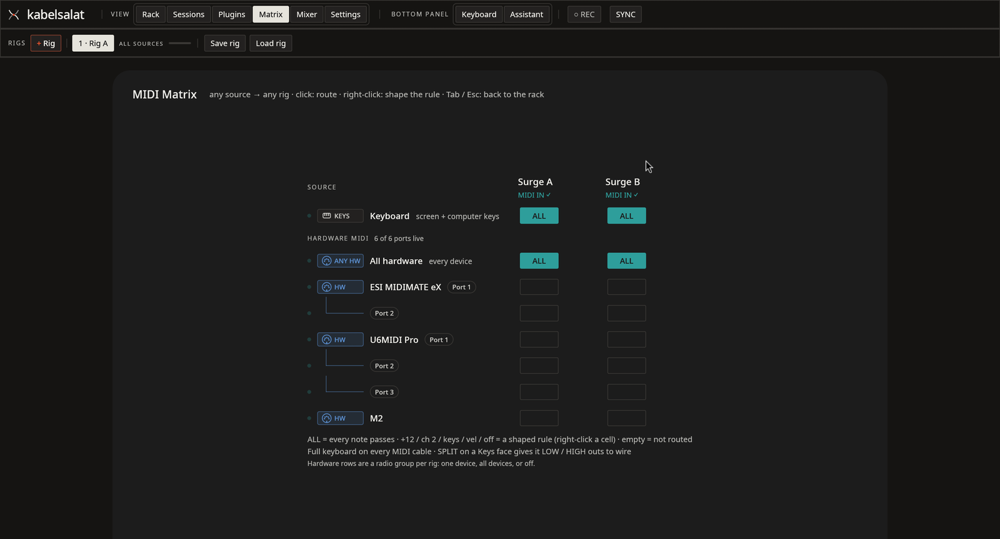

<p align="center">
  
</p>

<h1 align="center">kabelsalat</h1>

<p align="center"><strong>A live rack for Linux: plug in instruments, wire them up, play.</strong></p>

<p align="center">
  <a href="https://github.com/ssalentin/kabelsalat/releases"></a>
  <a href="LICENSE"></a>
  <a href="CONTRIBUTING.md"></a>
  
</p>

<p align="center">
  
</p>

kabelsalat turns your computer into a live setup like the ones built with
[AUM](https://kymatica.com/apps/aum) on the iPad: synths and effects sit in a
rack, connected by patch cables that you can see and grab, and everything you
play goes straight to the speakers. Several setups ("rigs") can sound at once,
each played from its own keyboard or controller.

## What you can do

### Play right away
Open the app and play with your laptop keyboard, the on-screen keyboard, or any
USB MIDI keyboard — devices are found while the app runs, just plug them in.
Starter setups (**F5–F8**) give you a lead with reverb, drums and bass, or an
ambient pad with one key.

The on-screen keyboard carries the controls a real keyboard has: a pitch-bend
wheel that springs back to centre, a modulation wheel, a sustain pedal and a
velocity slider. They reach every rig the keys feed, and hardware pitch bend,
modulation and sustain reach your instruments the same way.

<p align="center"></p>

### Patch with real cables
Press **Tab** to turn the rack around and patch on the back. Drag from jack to
jack to connect, drag a plug to move it, pull it off to unplug. The cables
sag and swing, and light up when signal flows through them.

<p align="center"></p>

### Run several rigs at once
**+ Rig** adds an independent setup with its own synth and output — for example
bass on one keyboard and pads on another. All rigs play together; switch the one
you are looking at with **1–9**. Any installed CLAP or LV2 instrument works
(Surge XT, Dexed, Vitalium, …), and each unit shows which instrument and sound
it has loaded.

### Put MIDI effects in front of an instrument
A **MIDI strip** sits between your keys and the instrument and changes the notes
on the way: the built-in **MIDI transpose**, or any installed LV2 MIDI plugin
(note transposers, filters, arpeggiators — pick one in **Plugins** and press
*Add MIDI strip*). The strip shows the plugin's own main controls, they can be
learned from a hardware knob like any other, and a note released while you turn
a knob never hangs. The assistant can add strips too (`list_midi_fx`, `add_node`
with kind `midi_fx`).

<p align="center"></p>

### Play your guitar
Plug a guitar (or a microphone) into your audio interface and press **⇧F5**: the
Guitar rig loads **Audio In → Scream → Delay → Reverb → Amp → Cabinet →
Master**. The Audio In unit picks any input by name, has a gain knob, a live
level meter, a **MON** switch for monitoring through the rig, and a built-in
**tuner** (note and cents) on its face. The stomps, amp and cabinet are the
Guitarix LV2 plugins from the Plugins browser (install the *Guitarix* card).
Monitoring goes through the same low-latency path as everything else; a missing
input says so instead of falling back to the laptop microphone.

<p align="center"></p>

### Mix
Every source gets its own channel strip: a fader in dB with a 0 dB detent
(double-click for exact unity), a held peak and a clip light, plus pan, mute
and solo. Each strip lists the effects on its cable chain as insert slots —
add, bypass, reorder or remove them — and the master has inserts that run on
the whole mix before the limiter. Every source and insert slot has a quick
parameter knob beside it (defaulting to the plugin's first main control or an
effect's mix; right-click to reassign, double-click to reset). Rename a strip,
give it a colour, drag it to reorder or collapse it; names, colours and quick
knob assignments are saved with the session.

<p align="center"></p>

### Navigate rigs, channels and plugins
Press **Q** (or click **Navigator** in the top bar) to open the right-hand
Navigator panel. Switch between **CHANNELS**, **PLUGINS** and **ALL** to see
every rig's channels in their mixer colours and unfold their plugin chains
(**CLAP**, **LV2** and **built-in**). Clicking an entry switches to that rig
and selects the unit in the rack or scrolls and flashes its strip in the mixer.

### Route MIDI anywhere
The MIDI matrix decides which keyboard plays which rig. Each connection can be
shaped: only some keys (keyboard splits), another MIDI channel, transposed, or
only loud notes.

<p align="center"></p>

### Control knobs from your controller
Right-click any knob, turn a knob on your MIDI controller — bound. The knob
shows its CC number and follows your hardware from then on.

### Record your set
**REC** records exactly what you hear into a WAV file in `~/Music/kabelsalat/`.
After stopping you can play the take back or open its folder; **SYNC** starts
and stops the recording with the transport. For stems, press **R** on a rig's
bus strip in the mixer: every armed rig records its own post-fader WAV, named
after the rig, into the same take folder as the master mix (**ARM** under
Master out). Pressed while the transport rolls, REC starts and stops on the
next bar; stopping the transport keeps recording so reverb tails are not cut.

### Play along with a backing track
Ask the assistant (or an MCP agent) to play a WAV file and it mixes into the
master like AUM's FilePlayer: **loop** restarts it seamlessly, **sync** plays it
at the transport tempo from its original BPM (a "120 bpm" in the file name is
picked up; speed changes, pitch follows, no time-stretch), **beats** sets the loop
length in beats so an aligned loop never drifts off the metronome, and **offset**
shifts the start. With sync on and the transport rolling, it starts on the next
bar line.

### Ask the assistant — or your own AI agent
The built-in assistant (bring your own DeepSeek key) can set things up for you:
"add a reverb to this rig", "split the keys at C4", "load a warm pad". Everything
an agent changes lights up in the rack, and **Ctrl+Z** undoes the whole request
in one step. External AI agents (Claude, …) can drive the running app through
the built-in MCP server; the top bar shows when one is connected and pauses it
with one click.

<p align="center"></p>

Press **?** in the app for every shortcut.

## Install

**AppImage (recommended)** — download the latest release for your machine:

- [kabelsalat-x86_64.AppImage](https://github.com/ssalentin/kabelsalat/releases/latest/download/kabelsalat-x86_64.AppImage) (most PCs and laptops)
- [kabelsalat-aarch64.AppImage](https://github.com/ssalentin/kabelsalat/releases/latest/download/kabelsalat-aarch64.AppImage) (ARM: Raspberry Pi 4/5, Asahi, Snapdragon)

```sh
chmod +x kabelsalat-*.AppImage
./kabelsalat-*.AppImage
```

Older versions and the other packages are on the
[releases page](https://github.com/ssalentin/kabelsalat/releases).

It runs unsandboxed, so it finds the CLAP/LV2 plugins installed on your system
and gets realtime audio priority like a native install. Install the plugins
from your distribution (`surge-xt` for the default synth).

**Arch / Omarchy** (builds the package with a launcher entry and icon):

```sh
git clone https://github.com/ssalentin/kabelsalat.git
cd kabelsalat/packaging
makepkg -si
```

Recommended: `surge-xt-clap` (the default synth). Optional: `dexed-clap`,
`lv2-plugins`.

**Flatpak / tarball** — also attached to every release. The Flatpak runs in a
sandbox: no realtime audio priority yet and `kabelsalat mcp --attach` from the
host cannot reach it; see [docs/PACKAGING.md](docs/PACKAGING.md).

**From source** — needs Rust (rustup), `alsa-lib`, `lilv`, and PipeWire or ALSA:

```sh
git clone https://github.com/ssalentin/kabelsalat.git
cd kabelsalat
cargo run --release
```

## Contributing

Pull requests are welcome! Start with [CONTRIBUTING.md](CONTRIBUTING.md) and
issues labelled
[`good first issue`](https://github.com/ssalentin/kabelsalat/labels/good%20first%20issue)
or [`help wanted`](https://github.com/ssalentin/kabelsalat/labels/help%20wanted).
Changes are listed in [CHANGELOG.md](CHANGELOG.md); planned work is in the
[issues and milestones](https://github.com/ssalentin/kabelsalat/milestones), and
how it is built in [docs/ARCHITECTURE.md](docs/ARCHITECTURE.md).

---

## Technical details

- **Engine:** Rust, a lock-free and allocation-free render path on a realtime
  thread (rtkit), 256-frame buffer (≈ 5.3 ms at 48 kHz). Hardware MIDI reaches
  the engine from its own thread, so sound never waits for a UI frame. A
  zero-latency master limiter sits before the master saturation.
- **Plugins:** CLAP via [clack](https://github.com/prokopyl/clack) (scanned out of
  process, so a crashing plugin cannot take the app down), LV2 via lilv on a
  loader thread. Plugin editors are native egui panels — no floating plugin
  windows.
- **Graph and rigs:** every rig is a graph of nodes and cables; rigs are merged
  into one engine graph and mixed per rig. Routing changes always release held
  notes first (checked exhaustively by the `verify-held-notes` test).
- **UI:** egui/eframe, physics-simulated cables, follows the
  [Omarchy](https://omarchy.org) desktop theme, native fractional HiDPI.
- **Agents:** `kabelsalat mcp` (headless) or `kabelsalat mcp --attach` (drives the
  running app) exposes the same control plane the UI uses — every UI action has
  an agent tool. `kabelsalat send '<json>'` is a one-shot CLI client.
- **Testing:** a unit suite (`cargo test --bin kabelsalat`) plus CLI self-tests
  that run real plugins (`record-test`, `rig-mix-test`, `cc-map-test`,
  `transport-test`, …). Rules learned from real bugs are kept in
  [AGENTS.md](AGENTS.md).
- **Platforms:** developed and tested on Asahi Linux (Arch, ARM64); x86_64 Linux builds the same way.

## The name

*Kabelsalat* is German for "cable salad" — the tangled mess behind every desk.
This app turns it into something you want to look at.

## Inspiration & prior art

- [AUM](https://kymatica.com/apps/aum) (Kymatica) — the live workflow this brings to Linux
- Reason (Reason Studios) — the rack flip: front to play, back to patch
- GarageBand (Apple) — instant sound, no manual needed
- [Surge XT](https://surge-synthesizer.github.io/) — reference instrument
- [clack](https://github.com/prokopyl/clack), [Maolan](https://github.com/maolan/maolan) — Rust plugin hosting
- [Element](https://github.com/kushview/element), [Carla](https://github.com/falkTX/Carla) — the Linux hosts that showed the gap

## License

[MIT](LICENSE) © Sebastian Salentin and contributors.
