<p align="center">
  
</p>

<h1 align="center">kabelsalat</h1>

<p align="center"><strong>A live rack for Linux: plug in instruments, wire them up, play.</strong></p>

<p align="center">
  <a href="https://github.com/ssalentin/kabelsalat/releases"></a>
  <a href="LICENSE"></a>
  <a href="CONTRIBUTING.md"></a>
  
</p>

<p align="center">
  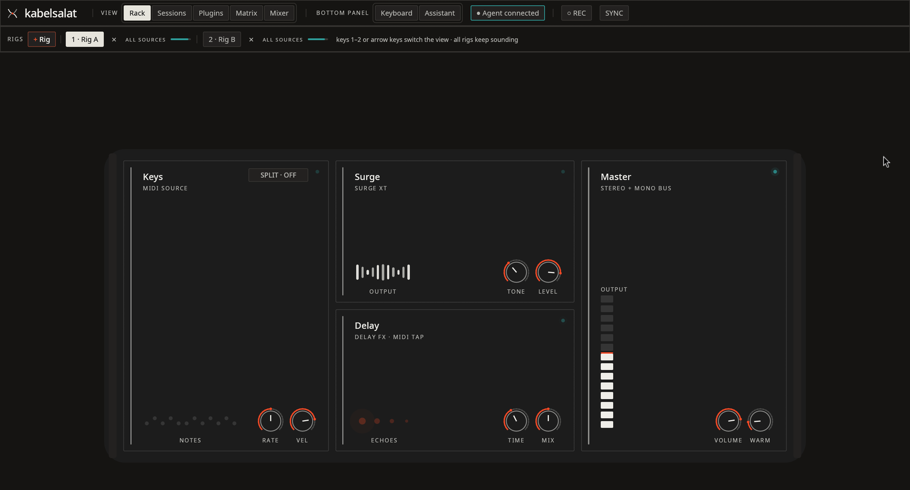
</p>

kabelsalat turns your computer into a live setup like the ones built with
[AUM](https://kymatica.com/apps/aum) on the iPad: synths and effects sit in a
rack, connected by patch cables that you can see and grab, and everything you
play goes straight to the speakers. Several setups ("rigs") can sound at once,
each played from its own keyboard or controller.

## What you can do

### Play right away
Open the app and play with your laptop keyboard, the on-screen keyboard, or any
USB MIDI keyboard — devices are found while the app runs, just plug them in.
Starter setups (**F5–F7**, **Shift+F5–F7**) give you a cathedral pipe organ,
a jazz or rock tonewheel organ, an ambient pad, a synth lead or a guitar rig
with one key. They use a handful of free plugins (Aeolus, setBfree, Surge XT,
Guitarix); a setup whose plugins are missing is greyed out in Sessions with an
Install button.

Every rig is a kind of instrument: piano, e-piano, jazz organ, pipe organ,
synth, bass, wind or drums. kabelsalat knows it from the plugin (setBfree is an
organ, AVL Drumkits are drums, Starbreath is a wind) or from the sound you load
(a Surge XT "Winds/Flute" makes the rig a wind). You can also mark a rig as a
type yourself; the mark is saved with the session. The left rail, the Plugins
browser, the demo phrase and the agent all use the same type.

The on-screen keyboard (**V**) turns into the instrument the active rig is:

- **Piano:** damper and soft pedals, touch velocity from where you hit the key
  (soft at the top, loud at the bottom), sustained notes marked in teal.
- **Jazz Organ** (setBfree): the nine drawbars, JAZZ/ROCK/GOSPEL/FLUTE
  registrations, Leslie STOP/SLOW/FAST, swell pedal, percussion, and two
  stacked manuals on MIDI channels 1 and 2. Drag across the keys for a
  glissando.
- **Pipe Organ** (Aeolus): division tabs, the stop jamb, six pistons,
  tremulant, couplers (II/I, III/I, …) and the swell pedal.
- **Synth:** pitch-bend and modulation wheels, the patch's own macro knobs and
  an X/Y pad over the first two, scale highlight and FOLD (only the scale's
  notes as keys), arpeggiator switch, sustain and velocity.
- **E-Piano:** damper, touch velocity and a tremolo wheel.
- **Bass:** a four-string neck beside the keys that shows where each held
  note lies, and that you can play.
- **Wind:** a breath control that sends CC 2, CC 11 or aftertouch, and
  Y-BREATH: how far down the key you play sets the breath.
- **Drums:** sixteen pads on the General MIDI drum notes in place of keys.

Keys sound for as long as you hold them, and the chord you hold is named in the
header. The agent can read and switch all of this too (`get_keyboard_state`,
`set_keyboard_mode`).

<p align="center"></p>

**EXPAND** (**Shift+V**) turns the whole window into the instrument, without the
rack (Esc or DOCK brings it back), and the instrument moves as you play:

- **Piano:** the open case shows strings, dampers and hammers. A note's hammer
  rises and its string swings, and the dampers lift with the sustain pedal.
- **Jazz Organ:** a tone generator whose wheels light up for every pulled
  drawbar of the notes you hold, full-length drawbars with the registration
  written out ("88 8000 000"), preset keys, the rotary speaker spinning up and
  down, one or two manuals and the swell shoe.
- **Pipe Organ:** a pipe front where each sounding note's pipe speaks, every
  division's drawknobs at once, couplers, tremulants, thumb pistons, and swell
  shutters that open with the swell shoe.
- **Synth:** a display with the patch and a scope, the patch's macro knobs, a
  large X/Y pad, and full-height pitch and mod wheels.

<p align="center">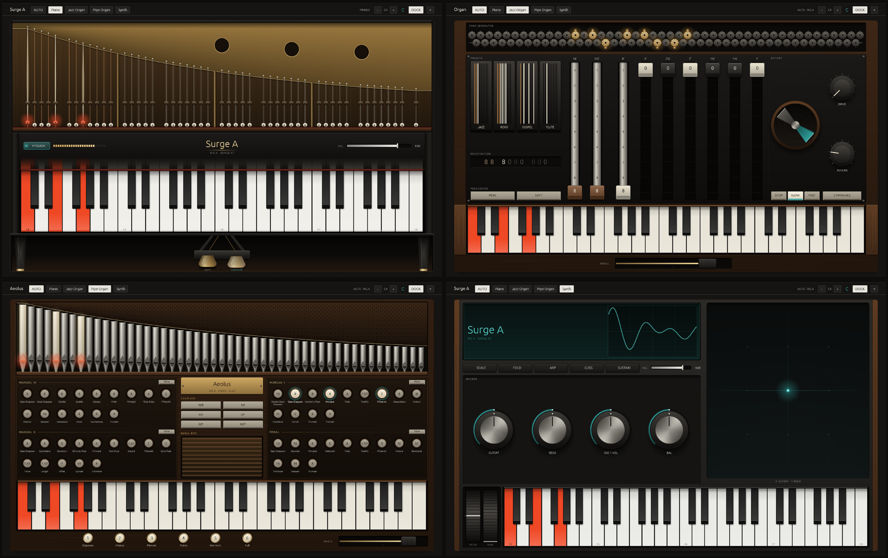</p>

- **E-Piano:** a tine per key that lights and swings while its note sounds,
  the tremolo wheel and the sustain pedal.
- **Bass:** a full neck to fifteen frets, with each held note on the string
  and fret a bassist would use.
- **Wind:** the breath column and an air column that shortens as the note
  rises and fills with the breath you give it.
- **Drums:** a kit seen from above, where you hit each drum and cymbal
  (harder in the middle), next to a 4×4 pad bank.

<p align="center"></p>

### Patch with real cables
Press **Tab** to turn the rack around and patch on the back. Drag from jack to
jack to connect, drag a plug to move it, pull it off to unplug. The cables
sag and swing, and light up when signal flows through them. Hover any jack to
trace its connected cables (dimming unrelated routes) and read a live port
tooltip with connections and signal level (dBFS for audio, active/recent notes
for MIDI). Right-click any cable or occupied jack to cycle its jacket color
within its family palette (warm for audio, cool for MIDI) or unplug every
cable on that jack. Dial **Cable opacity** and **Cable tension** from the
bottom-right controls on the back panel or under **Settings → Display** to tame
dense racks without losing cable physics.

Right-click any unit plate on the front or back to open its context menu:
**Bypass / Enable** (**Ctrl+E**), **Duplicate unit** (**Ctrl+D**, copying its
parameters and plugin state into the rig), **Initialize parameters**,
**Randomize parameters** (**Ctrl+R**, within sensible musical bounds as one
undo step), **Copy / Paste settings** between compatible units, **Unplug all
cables**, **Open plugin GUI**, or **Remove unit**. Bypassed units dim on both
front and back faces with a `BYPASSED` chip (click it to re-enable), stay in
sync with the mixer, release held notes safely, and keep delay compensation
intact. Agents and MCP clients have the same actions (`set_node_bypass`,
`duplicate_node`, `reset_node_params`, `randomize_node_params`).

<p align="center">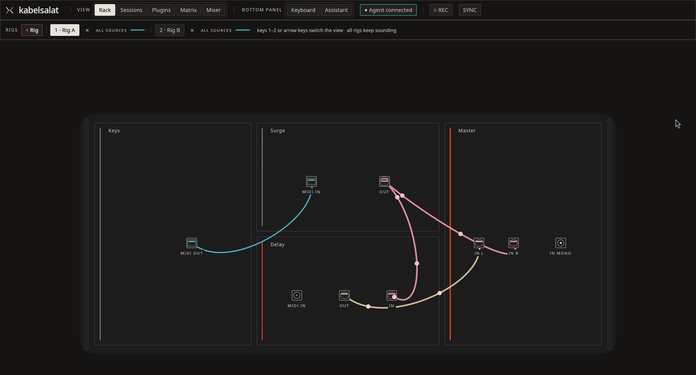</p>

### Run several rigs at once
**+ Rig** adds an independent setup with its own synth and output — for example
bass on one keyboard and pads on another. A session holds up to 32 rigs, enough
to keep every sound of a gig loaded. All rigs play together; switch the one you
are looking at with **1–9** or **← →**, or pick any rig from the Left Rail or
the top bar, which scroll when there are many. Any installed CLAP or LV2 instrument works
(Surge XT, Dexed, Vitalium, …), and each unit shows which instrument and sound
it has loaded. Every rig row in the Left Rail (**Q**) has a **▶** demo button
that loops a live musical phrase suited to its sound (keys, bass, lead, pad,
organ, drums, or wind with CC 2 and aftertouch breath) on the engine clock at
the session tempo — turn knobs, swap sounds or add effects and hear them right
away without a MIDI keyboard (`play_demo` / `stop_demo` for agents).

### Play a setlist without a gap
Press **F12** (or click **Setlist**) to organize a gig into songs and parts
(Verse, Chorus, Solo) over the loaded rigs. Every rig stays loaded; each part
says which rigs take new notes, with per-rig key range, transpose, level, pan,
effect-chain bypasses and stored knob values (including pinned plugin knobs),
and each song can set its own tempo and time signature.
One hosted instrument can be shared across as many songs as you like (a piano in
twenty songs hosts one plugin instance, with each song's own level, pan, split,
effect chain and knobs applied at the switch without cutting held notes);
**Add song from session** shares matching hosted instruments (same plugin and
saved preset) automatically, while a different preset or **Own instance** hosts
a separate instance so switching never reloads plugin state mid-show. The
Setlist header shows how many instrument instances the show really hosts, and a
show-level rig has **Vary per song** to keep that one instance in every song
while customizing it per song.
Each rig also takes a velocity range and curve, so a soft pad can sit under a
hard-struck piano, and a floating split: its key range's edges follow the hand
that plays across them, by up to the set number of keys.
Switching parts never cuts held notes or reverb tails — outgoing rigs keep
sounding until you release the keys or sustain pedal, while new notes play the
next part from the same audio block on. A part that moves a rig's fader, pan,
an instrument's level or an effect's bypass ramps it over 5 ms, so a
chord held through the switch does not click.
`kabelsalat setlist-switch-test` measures a switch under a held chord with real
Surge XT voices (including switching between two songs that share one instance):
no gap, no click, the reverb and delay tails ring on, and the
first note of the next song starts in the block that switched (at most one
buffer later, 5.3 ms at the default 256 frames, plus the sound card's own
output latency). Step parts from the top bar, with
**PageUp / PageDown** (**Shift+PageUp / Shift+PageDown** for songs — works with
page-turner pedals), or from a pedal or button you learned (see "Run the show
from a pedal"). Under **Program change picks the song**, turn a keyboard or
foot controller on, and its preset buttons pick songs: program change N jumps
to song N+1 in the next audio block, and that device's program changes no
longer reach its instruments (other devices' still do). **Add song from
session** pulls a saved session into the gig as a new song (reusing matching
hosted instruments by default), and the
assistant and MCP agents can read, build and step the setlist.

<p align="center">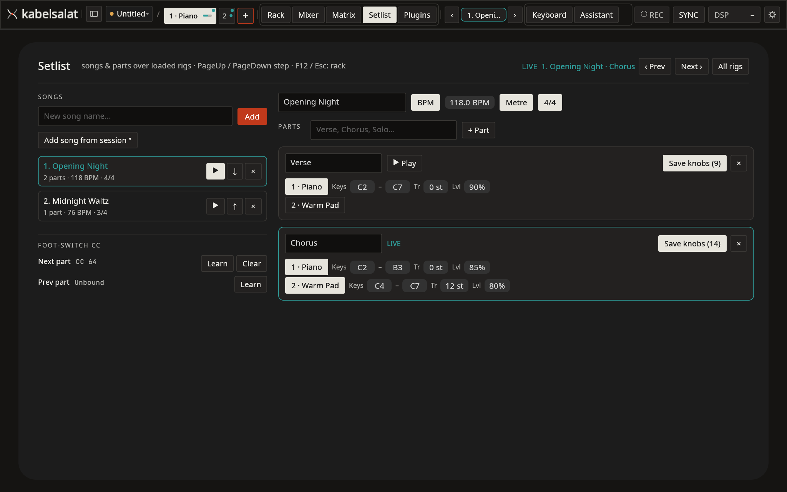</p>

### Keep what stays through the whole show
A vocal mic, a master reverb or a volume pedal is set up once and stays through
every song. Each rig, aux bus and MIDI controller binding lives at **show**
level (no song switch touches it: it keeps the whole keyboard, its fader and
its knobs), at the level of a **set** (a named group of songs) or at **song**
level (only where the setlist's parts use it). A rig or bus a part uses is at
song level by itself; everything else is at show level, which is also how
older sessions load. Group songs into sets under **Setlist → Sets & levels**,
move a set or skip it as a whole, and choose each level there or on the
mixer's bus strips. Agents read and set them with `get_setlist`, `set_level`
and `set_setlist_set`.

<p align="center">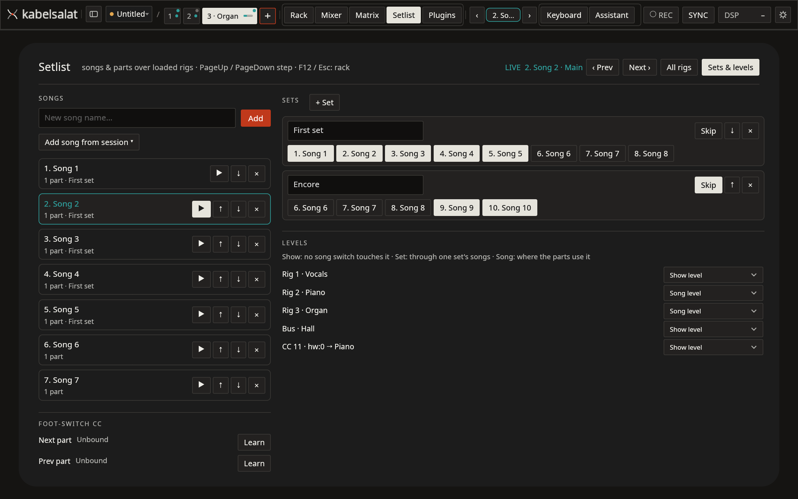</p>

### Go on stage with Show mode
Click **Show mode** in the Setlist header (agents: `set_show_mode`) for a
full-window stage screen you can read from two metres away: the current song
and part in large type, the next song, tempo and time signature, the master
meter, one meter per rig that plays in this part, and a clock. Editing is
locked while it is open: no click or key moves a cable, a fader or a song.
PageUp / PageDown (Shift for songs) and a foot switch still step the setlist,
**Panic** sends all notes off on every rig (agents: `panic`), and to leave
you hold **Esc** until its line fills (a second), then let go.

<p align="center"></p>

### Check the show before the first song
**Setlist → Check show** finds what could go wrong while there is still time to
fix it, and changes nothing: every MIDI device the show binds is plugged in,
the chosen output and every Audio In device are connected, every plugin is
installed and loads, every rig makes sound (each plays its demo phrase in an
offline engine of its own), every song's backing track is on disk, there is
room to record, the buffer has headroom, and the laptop runs on mains power.
Each check says ok, warning or problem, and what to do about it. Agents get the
same list from the `preshow_check` tool, and `kabelsalat preshow-check
<session.ksalat>` prints it in a terminal (exit status 1 on a problem).

<p align="center">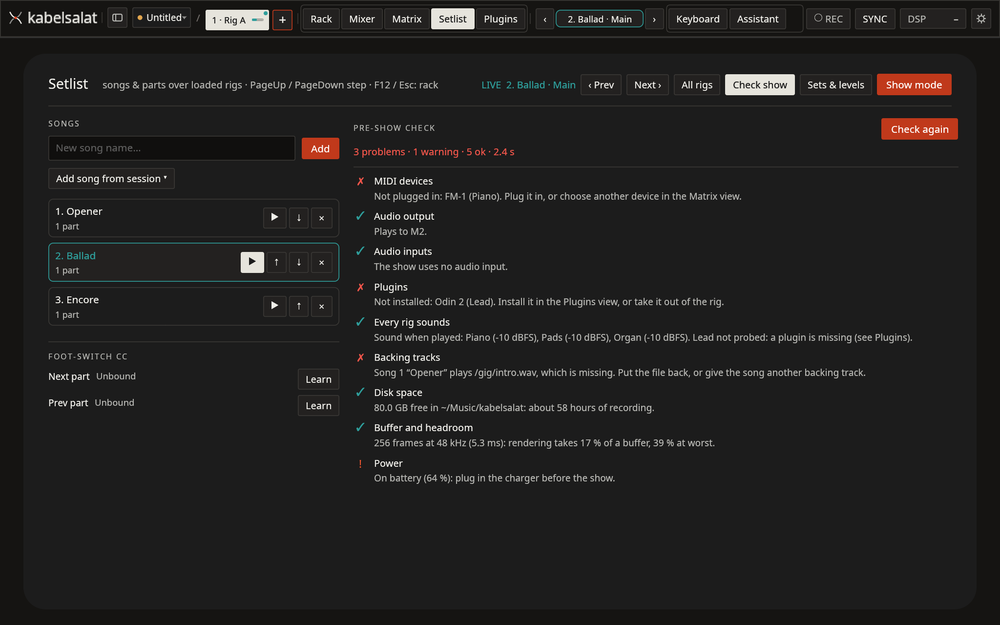</p>

### Run the show from a pedal
Every show action has a row under **Setlist → Show controls**: next and
previous song, next and previous part, Panic, tap tempo, tuner on/off, master
mute, start/stop the backing track and start/stop recording. Click **Learn**
and press a foot switch, a pad, a key or a preset button: a CC, a note or a
program change from that device is learned, like a knob's MIDI learn. From
then on its press does the action in the next audio block (the tuner and
recording a frame later), in every song and in Show mode, and it never reaches
an instrument; a key held while it is learned still gets its release. One
message does one action: learning it for another moves it there. The devices
whose program change picks the song are rows of the same list. The tuner shows
the note the first Audio In plays and how many cents it is off; click it to
close it. Agents list and set the controls with `get_show_controls` and
`set_show_control`.

<p align="center"></p>

<p align="center">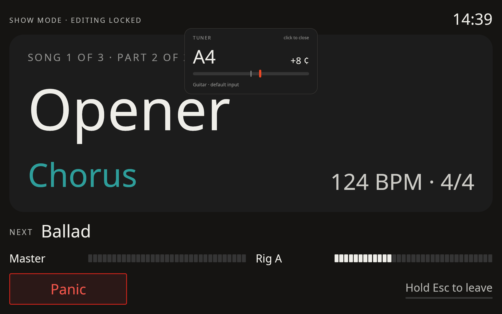</p>

### Browse and install plugins by type
Press **F9** (or **B**) to open **Plugins**, organized by what each unit does
rather than by plugin format: **Instruments**, **Effects**, **MIDI FX**,
**Utilities** and the **Install** catalog. Narrow **Effects** by subcategory
(**Delay & Reverb**, **EQ & Filter**, **Dynamics**, **Drive & Amp**,
**Modulation**, **Pitch & Spatial**, **Multi-FX**) or filter by format
(**Built-in**, **CLAP**, **LV2**). Add an instrument as a **New rig** alongside
your existing rigs or layer it into the active rig, insert any effect onto the
active rig or straight onto the **Master FX** bus, and filter the mixer's
**+ insert** picker by the same effect categories. The assistant and MCP agents
search the same taxonomy with `list_plugins`.

<p align="center">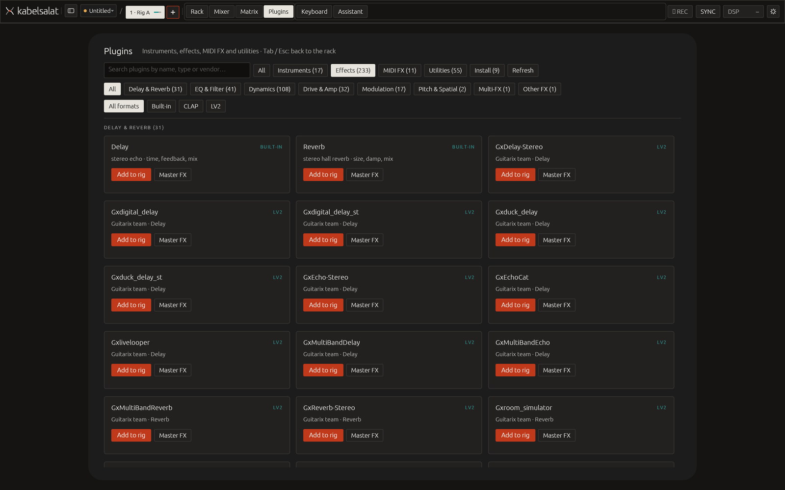</p>

### Install instruments from the catalog
**Plugins → Install** lists 23 hand-picked plugins that are known to work in
kabelsalat, and **Install** fetches one for you: the Arch package where there is
one, otherwise a pinned release or a build from source into `~/.clap` or
`~/.lv2`. Synths: Surge XT, Dexed, Vitalium, Odin 2, OB-Xf (Oberheim), the
Juno-style Ultramaster KR-106, Six Sines (FM), JC303 (TB-303), YANES (chiptune)
and Cardinal (modular). Keys and organs: setBfree, Aeolus, Unsampled Piano
(physically modelled acoustic grand piano), OneTrick KEYS (lo-fi modelled
piano). Bass and drums: OneTrick CHONK, OneTrick CRYPTID (FM drums),
AVL Drumkits (sampled kits). Winds: Starbreath, modelled flutes, reeds and
brass for a wind controller (freeware, x86-64 only). Effects and MIDI tools:
Floe (sample libraries), Guitarix, Dragonfly Reverb (Hall, Room, Plate and Early
Reflections CLAP reverbs), Airwindows Consolidated (hundreds of Chris Johnson's
studio processors in one CLAP effect) and the x42 MIDI filters (chord, strum,
mono legato, CC remap). A card says when a plugin has no build for your CPU, and
links its source code and website. See [docs/PLUGINS.md](docs/PLUGINS.md) for
which plugins have been tested, what works, and what is still untested.

### Put MIDI effects in front of an instrument
A **MIDI strip** sits between your keys and the instrument and changes the notes
on the way: the built-in **MIDI transpose**, or any installed LV2 MIDI plugin
(note transposers, filters, arpeggiators — pick one in **Plugins** and press
*Add MIDI strip*). The strip shows the plugin's own main controls, they can be
learned from a hardware knob like any other, and a note released while you turn
a knob never hangs. The assistant can add strips too (`list_midi_fx`, `add_node`
with kind `midi_fx`).

<p align="center"></p>

### Play your guitar
Plug a guitar (or a microphone) into your audio interface and press **⇧F5**: the
Guitar rig loads **Audio In → Scream → Delay → Reverb → Amp → Cabinet →
Master**. The Audio In unit picks any input by name, has a gain knob, a live
level meter, a **MON** switch for monitoring through the rig, and a built-in
**tuner** (note and cents) on its face. The stomps, amp and cabinet are the
Guitarix LV2 plugins from the Plugins browser (install the *Guitarix* card).
Monitoring goes through the same low-latency path as everything else; a missing
input says so instead of falling back to the laptop microphone.

<p align="center"></p>

### Mix
Every source gets its own channel strip: a fader in dB with a 0 dB detent
(double-click for exact unity), a held peak and a clip light, plus pan, mute
and solo. Each strip lists the effects on its cable chain as insert slots —
add, bypass, reorder or remove them — and the master has inserts that run on
the whole mix before the limiter. Every source and insert slot has a quick
parameter knob beside it (defaulting to the plugin's first main control or an
effect's mix; right-click to reassign, double-click to reset). Rename a strip,
give it a colour, drag it to reorder or collapse it; names, colours and quick
knob assignments are saved with the session.

**Master to a loudness.** Beside Master out, the Loudness column takes a
target: −14 LUFS (Spotify, YouTube, Tidal), −16 (Apple Music), −8 (club), or
any value in 1 LU steps. Play your loudest passage first; picking a target
then trims the level in front of the master limiter by what is missing, and
the true peak is held under −1 dBTP. The column shows the loudness before,
the loudness now, the true peak and the trim. **Match** measures what you
played since and corrects the trim; if the limiter has no more to give, the
readout says so and asks for more master VOLUME. The target is saved with
the session. The assistant and MCP agents do the same with
`set_master_target` and read the numbers with `get_master_target`.

Parallel paths stay in phase. When a signal splits and meets again, and one
path runs through a unit that takes time (the Limiter waits 5 ms to catch
peaks, and a hosted plugin reports its own latency: a look-ahead compressor,
a linear-phase EQ), the other paths of that sound wait for it, so a dry sound
and its processed copy add up cleanly instead of sounding hollow. Only paths
that carry the same sound wait: a latent effect on the pad never makes the
piano beside it late. When a plugin changes its latency while you play (you
turn its look-ahead up), the paths are back in phase a moment later. A
bypassed unit keeps its delay, so switching it in and out never shifts
anything in time. A strip that sounds late says by how much, in milliseconds
under its fader: what its plugins report plus what keeping it in phase adds.

<p align="center"></p>

### Share an effect with sends
**+ Aux bus** under the mixer's master strip adds a bus: a channel that nothing is cabled into.
Every rig bus and every source strip gets a **SENDS** row for it. Turn the
row's knob to send some of that signal to the bus (double-click: off or 0 dB)
and click **PRE** to tap it before the strip's fader, so the send keeps its
level when the fader moves. Put a reverb or a delay on the bus as an insert
and several rigs share it. The bus has its own fader, pan, mute and solo and
returns to the master past the rig faders; soloing it leaves only the returns.
Right-click a send knob to bind it to a hardware controller, like the faders.
Sends are saved with the session.

<p align="center">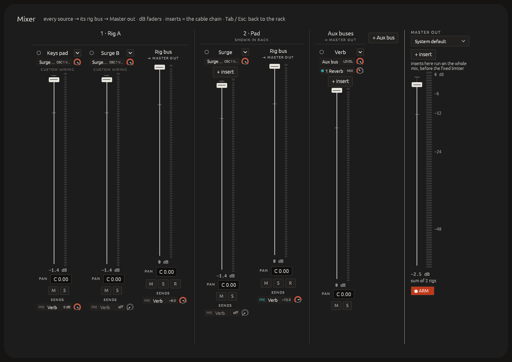</p>

### Mix the other apps and pick your sound card
Kabelsalat creates a native **PipeWire** audio node (`kabelsalat`) out of the
box — no `pipewire-alsa` bridge required — and you can switch audio backends
live under **Settings → Audio** (or with `KABELSALAT_AUDIO_BACKEND` /
`set_audio_backend`) between **Auto**, **PipeWire**, **JACK (`pipewire-jack`)**
(registers `Kabelsalat:out_1` and `out_2` for `qpwgraph` / `Helvum` / `qjackctl`),
and **ALSA** (with direct ALSA PCM device selection).

The backing track in your browser sits in the same mixer. Under **System
audio** every other app that is playing gets its own strip, named after the
app and what it plays, with a live meter, a volume fader and a mute button, so
you can turn YouTube down under your rig without leaving kabelsalat.
System-audio capture records those other apps' streams rather than the output
monitor, so mixing them into the master never feeds kabelsalat's own output
back, whichever sound card is chosen. At **Master out** a menu lists your sound
cards: pick your audio interface instead of the laptop speakers and the sound
moves there at once, without a dropout. The choice is remembered for the next
start, and **System default** hands the sound back to the system's output. The
assistant and MCP agents do the same (`list_app_streams`, `set_app_stream`,
`list_audio_outputs`, `set_audio_output`, `set_audio_backend`). System-audio
strips and live sink moves use PipeWire's Pulse layer (`pactl`, `parec`).

<p align="center">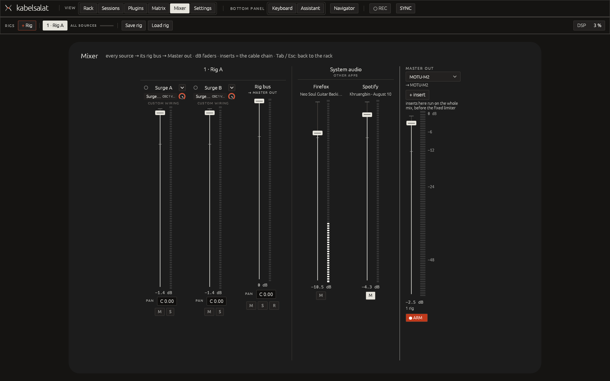</p>

### Send a bus to its own sound card
Every **rig bus** and every **aux bus** has an output menu under its name:
**Master out**, or one of your sound cards. A bus on its own card plays there
only and leaves the main mix. Put the metronome in a rig of its own and send
that rig's bus to the headphones, and the click never reaches the PA. For a
monitor mix, send your rigs pre-fader into an aux bus and give that bus the
headphones. The bus keeps its fader, pan, mute, solo and inserts. Up to four
cards besides the master's can play at once. The choice is saved with the
session. While its card is unplugged a bus is silent and its menu reads **not
available**; it never falls back to another output, and it plays again when
the card returns. A second card runs on its own clock, so a bus there can
arrive a few milliseconds apart from the master. The assistant and MCP agents
do the same (`set_bus_output`, `get_bus_outputs`). This needs PipeWire
(`pw-cat`, `pactl`).

<p align="center"></p>

### Navigate rigs, sessions and plugins
One top bar holds the session, the rigs and the views. The **session pill**
on the left (`● Untitled ▾`, teal once saved) opens a small popover to save,
load or delete sessions and start from a template (**Ctrl+O**). While the
left rail is closed, the bar shows the rigs as compact pills: the active one
as `1 · Lead` with a live level bar, the others as numbers with an activity
dot, and **+** adds a rig.

Press **Q** (or the rail button left of the session pill) to open the
**left rail**. Its **Rigs** tab lists every rig with its MIDI input, level and
a **⋯** menu (rename, save as or replace from a rig preset, MIDI input, delete), its channels in their mixer
colours and their plugin chains (**CLAP**, **LV2** and **built-in**); filter
with **ALL**, **CHANNELS** and **PLUGINS**. Clicking an entry switches to that
rig and selects the unit in the rack or scrolls and flashes its strip in the
mixer. The **Library** tab keeps sessions, rig presets and starter templates
in one place.

### Keep an eye on the engine
Beside your rigs, **DSP** shows how much of each audio buffer the engine needs
to render your rack. It turns amber from 70 % and red above 90 %, and counts
the dropouts (xruns) the sound card reported. Click it for **Engine info**:
sample rate and buffer, inputs and outputs, late blocks and xruns, the
latencies kabelsalat measures, and the render time of every instrument and
effect, most expensive first, so you see which unit to swap when the load
climbs. Press **F3** (or toggle **Rack CPU · F3** in Engine info) to paint a
live CPU meter directly on every unit of the rack — front and back — with a
hairline micro-bar and its share of the audio buffer budget (cream normal,
amber above 15 %, red above 30 %). Adjust the audio **Buffer size** (64–2048 frames, default 256) live
with **− / +** in Engine info or from **Settings → Audio** — smaller lowers latency,
larger prevents xruns — and the choice is remembered across restarts. The
assistant and MCP agents read and adjust the same engine settings
(`get_engine_info`, `set_buffer_size`).

### Route MIDI anywhere
The MIDI matrix decides which keyboard plays which rig. Each connection can be
shaped: only some keys (keyboard splits), another MIDI channel, transposed, or
only loud notes.

<p align="center"></p>

### Count in any metre
The metronome follows the time signature you pick: beats per bar and the note
that counts as one, under **Settings → Session**, or the chip on the metronome
that steps through 4/4, 3/4, 6/8, 5/4, 7/8 and 2/4. The first beat of each bar
clicks higher, the count-in lasts whole bars, and recording and a synced backing
track start and stop on the bar lines of that signature. Plugins you host are
told it too, and it is saved with the session.

<p align="center"></p>

### Be the clock
Switch on MIDI Clock Send in the matrix view and kabelsalat becomes the master
clock: 24 clocks per beat plus Start and Stop go to the MIDI outputs you wire
(drum machines, synths) and to a virtual port other apps can connect to. A sync
offset and three latency modes (none, output, input) line the clock up with what
you hear.

### Control knobs and the mixer from your controller
Drag any rack or mixer knob vertically; hold **Shift** while dragging for 10×
fine-tune control (holding **Ctrl** drags a unit to rearrange it), and
**double-click** any knob to reset it to its default. Hovering or dragging shows
real physical units (`Hz`, `ms`, `dB`, `%`, semitones, or the CLAP plugin's own
readout). Open a knob's right-click menu to type an exact value (`440 Hz`,
`250 ms`, `−6 dB`, `75%`, …) and press **Enter** — without getting in the way of
quick MIDI learn.

Right-click any knob, turn a knob on your MIDI controller — bound. The knob
shows its CC number and follows your hardware from then on.

The mixer learns the same way. Right-click a fader, a pan field, or a mute or
solo button on a source strip, a rig bus or the master, then move a fader or
press a button on your controller. A learned fader shows its CC beside the dB
readout, and every learned control gets a blue outline. Mute and solo follow
the button: on while it is latched (CC value 64 or more), off when it is
released. Right-click a learned control to limit a fader's range, learn it
again or clear it. The bindings are saved with the session and stay with their
rig when you add or delete rigs.

A whole hardware instrument maps in one step with an instrument profile. Pick
it for the instrument's port in the MIDI matrix (Nord Electro 2, Akai EWI 4000s
and Akai EWI 5000 are built in; more are MIDI Guide CSV files in
`~/.config/kabelsalat/instruments/`): the Nord's drawbars, rotary switch,
percussion and drive move the organ, while an EWI forwards CC 2 breath as
channel pressure alongside CC 2 so both breath-CC and aftertouch wind patches
respond (and the EWI 5000 is matched automatically by its USB port name). The
assistant and MCP agents do the same with `list_instrument_profiles` and
`set_device_instrument`: "the Nord is on the second port".

<p align="center"></p>

### Record your set
**REC** records exactly what you hear into a WAV file in `~/Music/kabelsalat/`.
After stopping you can play the take back or open its folder; **SYNC** starts
and stops the recording with the transport. For stems, press **R** on a rig's
bus strip in the mixer: every armed rig records its own post-fader WAV, named
after the rig, into the same take folder as the master mix (**ARM** under
Master out). Pressed while the transport rolls, REC starts and stops on the
next bar; stopping the transport keeps recording so reverb tails are not cut.

Forgot to press REC? kabelsalat keeps the last two minutes of the master and
of every armed rig in memory. Right-click **REC** and choose **Save the last
2:00**: it becomes a take folder like any recording, so the take you did not
plan is not lost. Settings → Audio → **Keep the last** sets how far back (1 to
10 minutes, or off); machines with under 3 GB of memory start with it off.
The assistant and MCP agents save it with `record_save_last`.

### Get back on stage after a crash
If kabelsalat crashes, it starts again by itself and reopens the session and
the setlist part you were on, so the next song is seconds away. It writes a crash report to
`~/.local/state/kabelsalat/crashes/` (under `$XDG_STATE_HOME` when that is
set): the version, what went wrong, the
plugins loaded and the last engine commands, and no folder or file names of
yours. Nothing is sent anywhere; the restarted app offers to open the folder
or a GitHub issue with the report filled in, which you send yourself. Set
`KABELSALAT_WATCHDOG=0` to run without the restart.

### Play along with a backing track
Ask the assistant (or an MCP agent) to play a WAV file and it mixes into the
master like AUM's FilePlayer: **loop** restarts it seamlessly, **sync** plays it
at the transport tempo from its original BPM (a "120 bpm" in the file name is
picked up; speed changes, pitch follows, no time-stretch), **beats** sets the loop
length in beats so an aligned loop never drifts off the metronome, and **offset**
shifts the start. With sync on and the transport rolling, it starts on the next
bar line. A setlist song can name its backing track (`set_setlist_song` with
`backing`): selecting the song starts it, and a song without one stops it.

### Ask the assistant — or your own AI agent
The built-in assistant (bring your own [OpenRouter](https://openrouter.ai/keys)
key, entered under **Settings → Agent → API key**) can set things up for you:
"add a reverb to this rig", "split the keys at C4", "load a warm pad". One key
reaches every model: **Settings → Agent → Models** picks the chat model, the
decisions model and the listening model, or takes any OpenRouter model id. While
it works, the assistant says what it is doing ("Planning the next step · after
Load sound"), and when it listens to your sound a bar shows how long it still
records, in the dock, on the top bar's button and on the rack's hint line.
Don't want it? Switch **Assistant** off on the same page and it leaves the top
bar and the dock. Everything
an agent changes lights up in the rack, and **Ctrl+Z** undoes the whole request
in one step. External AI agents (Claude, …) can drive the running app through
the built-in MCP server; the top bar shows when one is connected and pauses it
with one click.

<p align="center">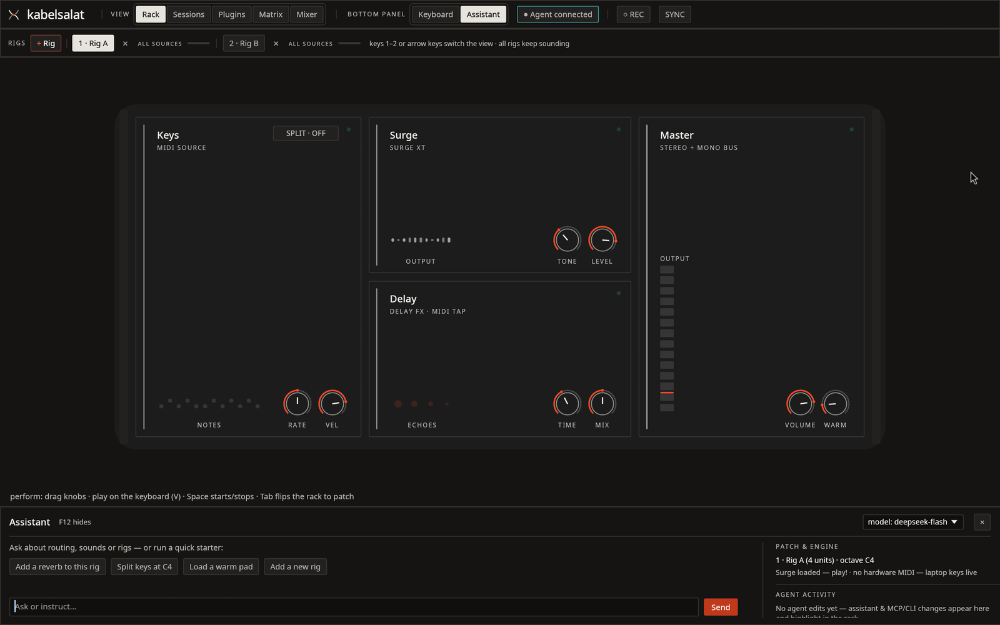</p>

Press **?** in the app for every shortcut.

## Install

**AppImage (recommended)** — download the latest release for your machine:

- [kabelsalat-x86_64.AppImage](https://github.com/ssalentin/kabelsalat/releases/latest/download/kabelsalat-x86_64.AppImage) (most PCs and laptops)
- [kabelsalat-aarch64.AppImage](https://github.com/ssalentin/kabelsalat/releases/latest/download/kabelsalat-aarch64.AppImage) (ARM: Raspberry Pi 4/5, Asahi, Snapdragon)

```sh
chmod +x kabelsalat-*.AppImage
./kabelsalat-*.AppImage
```

Older versions and the other packages are on the
[releases page](https://github.com/ssalentin/kabelsalat/releases).

Text fields read the keyboard directly, not through an input method. To
write Chinese, Japanese or Korean, start it with `KABELSALAT_IME=1`.

It runs unsandboxed, so it finds the CLAP/LV2 plugins installed on your system
and gets realtime audio priority like a native install. Install the plugins
from your distribution (`surge-xt` for the default synth).

**Arch / Omarchy** (builds the package with a launcher entry and icon):

```sh
git clone https://github.com/ssalentin/kabelsalat.git
cd kabelsalat/packaging
makepkg -si
```

Recommended: `surge-xt-clap` (the default synth). Optional: `dexed-clap`,
`lv2-plugins`.

**Flatpak / tarball** — also attached to every release. The Flatpak runs in a
sandbox: no realtime audio priority yet and `kabelsalat mcp --attach` from the
host cannot reach it; see [docs/PACKAGING.md](docs/PACKAGING.md).

**From source** — needs Rust (rustup), `alsa-lib`, `lilv`, and PipeWire or ALSA:

```sh
git clone https://github.com/ssalentin/kabelsalat.git
cd kabelsalat
cargo run --release
```

## Roadmap

The goal: **the best open source live performance DAW for Linux, with
instruments built by the community. Fast, professional, but easy to use.**
For live playing, MainStage is the bar.

| Version | Theme |
|---|---|
| 0.3 | The MainStage for Linux: a whole gig from one setlist |
| 0.4 | Trust it on stage: a plugin crash never stops the show |
| 0.5 | Instruments by the community: SFZ instruments and an open catalog |
| 0.6 | Runs everywhere, plays everything: VST3 and packages for your distribution |
| 0.7 | Controllers and remote |
| 0.8 | Practise and create: looper, practice tools, multi-take recording |
| 0.9 | The assistant, on your terms: local models |
| 1.0 | A promise of stability: old sessions keep loading |

The [roadmap to v1.0](https://github.com/ssalentin/kabelsalat/issues/272)
lists the issues behind each version.

## Contributing

Pull requests are welcome! Start with [CONTRIBUTING.md](CONTRIBUTING.md) and
issues labelled
[`good first issue`](https://github.com/ssalentin/kabelsalat/labels/good%20first%20issue)
or [`help wanted`](https://github.com/ssalentin/kabelsalat/labels/help%20wanted).
Changes are listed in [CHANGELOG.md](CHANGELOG.md); planned work is in the
[roadmap](https://github.com/ssalentin/kabelsalat/issues/272) and its
[milestones](https://github.com/ssalentin/kabelsalat/milestones), and
how it is built in [docs/ARCHITECTURE.md](docs/ARCHITECTURE.md).

---

## Technical details

- **Engine:** Rust, a lock-free and allocation-free render path on a realtime
  thread (rtkit), 256-frame buffer (≈ 5.3 ms at 48 kHz). Hardware MIDI reaches
  the engine from its own thread, so sound never waits for a UI frame. A
  zero-latency master limiter sits before the master saturation.
- **Plugins:** CLAP via [clack](https://github.com/prokopyl/clack) (scanned out of
  process, so a crashing plugin cannot take the app down), LV2 via lilv on a
  loader thread. Plugin editors are native egui panels — no floating plugin
  windows.
- **Graph and rigs:** every rig is a graph of nodes and cables; rigs are merged
  into one engine graph and mixed per rig. Routing changes always release held
  notes first (checked exhaustively by the `verify-held-notes` test).
- **UI:** egui/eframe, physics-simulated cables, follows the
  [Omarchy](https://omarchy.org) desktop theme, native fractional HiDPI.
- **Agents:** `kabelsalat mcp` (headless) or `kabelsalat mcp --attach` (drives the
  running app) exposes the same control plane the UI uses — every UI action has
  an agent tool. `kabelsalat send '<json>'` is a one-shot CLI client.
- **Testing:** a unit suite (`cargo test --bin kabelsalat`) plus CLI self-tests
  that run real plugins (`record-test`, `rig-mix-test`, `cc-map-test`,
  `transport-test`, …). `analysis-test` checks the engine by what it sounds
  like: a note's pitch, brightness and aliasing from its spectrum, the
  master's crackle, routing proven with noise, and delay compensation by
  cross-correlation. Rules learned from real bugs are kept in
  [AGENTS.md](AGENTS.md).
- **Platforms:** developed and tested on Asahi Linux (Arch, ARM64); x86_64 Linux builds the same way.

## The name

*Kabelsalat* is German for "cable salad" — the tangled mess behind every desk.
This app turns it into something you want to look at.

## Inspiration & prior art

- [AUM](https://kymatica.com/apps/aum) (Kymatica) — the live workflow this brings to Linux
- Reason (Reason Studios) — the rack flip: front to play, back to patch
- GarageBand (Apple) — instant sound, no manual needed
- [Surge XT](https://surge-synthesizer.github.io/) — reference instrument
- [clack](https://github.com/prokopyl/clack), [Maolan](https://github.com/maolan/maolan) — Rust plugin hosting
- [Element](https://github.com/kushview/element), [Carla](https://github.com/falkTX/Carla) — the Linux hosts that showed the gap

## License

[MIT](LICENSE) © Sebastian Salentin and contributors.
