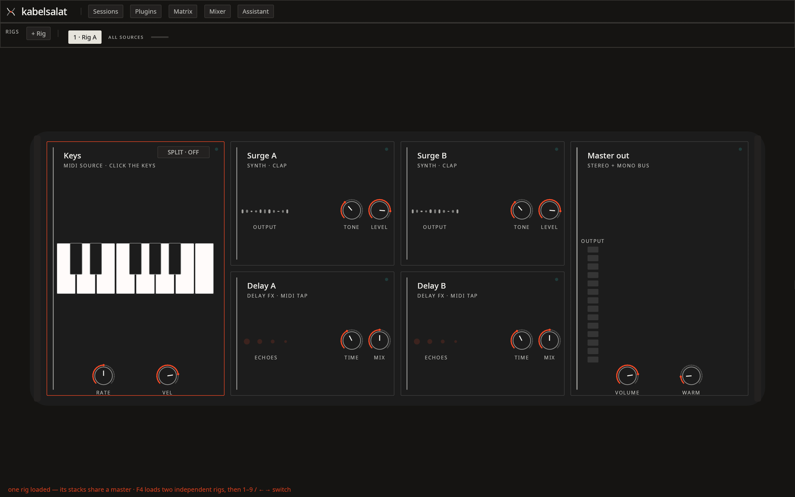
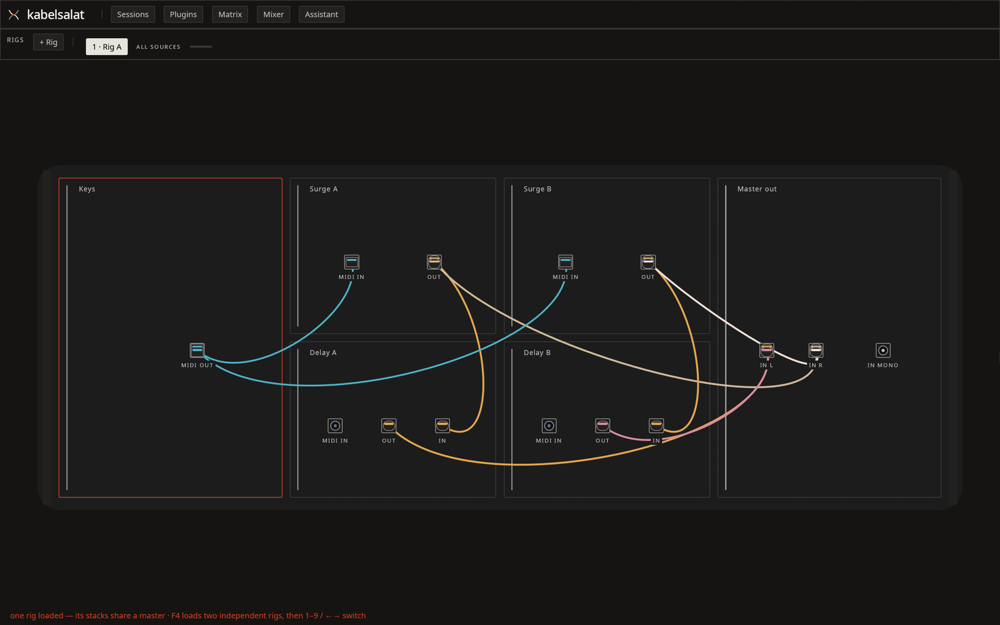

<p align="center">
  
</p>

<h1 align="center">kabelsalat</h1>

<p align="center"><strong>Live audio/MIDI wiring, alive.</strong></p>

A live plugin host for Linux, written in Rust — [AUM](https://kymatica.com/apps/aum)'s
routing workflow with GarageBand's approachability. Wire plugins and audio sources
into a graph, route MIDI anywhere, and play live — while the signal flows through
cables that **sag, swing, and glow**.

> **Status: working dev preview.** Multiple independent rigs, a live MIDI matrix
> and mixer, CLAP + LV2 hosting with native editors, and an MCP server are live.
> Still evolving. The plan and progress are public: [PLAN.md](PLAN.md).

<p align="center">
  
  
</p>
<p align="center"><em>Front (perform) and back (patch). <strong>Tab</strong> flips the rack.</em></p>

## The idea

Linux has capable plugin hosts, but none combine AUM's live workflow with a modern
interface. kabelsalat is that gap:

- **Animated wiring is the signature.** Cables hang like real patch leads, MIDI
  notes launch visible pulses along them, audio cables breathe with their level,
  and dragging a node makes its cables swing and settle. You *see* your signal path.
- **Reason's rack flip** — labeled rack units up front; press **Tab** to flip the
  rack and patch the cables on the back. Cables swing, dangle, and beg to be grabbed.
- **GarageBand-inspired approachability** — playable starter templates, smart macro
  controls, slick 60fps interactions, instant sound. No manual required.
- **Agent-native** — a full MCP server gives AI agents 1:1 access to every feature,
  through the same control plane the UI uses. Plus a **built-in assistant**
  (DeepSeek, bring-your-own-key) that can inspect, play, and help set things up.
- **One window, no scatter** — plugin parameters open in a native editor inside
  the app, never as disconnected plugin windows.
- **System audio in the mix** — wire YouTube/browser playback straight into a
  channel (PipeWire monitor capture).
- **MIDI matrix** — route any source to any destination with channel filters,
  transpose, and key-range **splits & layers** for live playing.
- **Mixer channels** — source nodes, insert FX (pre/post fader), sends, and buses.
- **CLAP + LV2 plugin hosting** (Surge XT is the reference plugin).
- **Built for ARM64 too** — developed on Asahi Linux (M1), native plugins only.
- Follows the [Omarchy](https://omarchy.org) desktop theme, keyboard-first.

No timeline, no arranger. The graph is the instrument.

## What works today

- **Data-driven rack.** A graph of nodes wired by physical, animated cables.
  **Tab** flips front (perform) and back (patch bay). Drag jack to jack to patch,
  drag a plug to move it, **Ctrl**+drag a unit to rearrange.
- **Multiple rigs.** **+ Rig** adds an independent, playable rig (Keys → Surge →
  Master). Each rig has its own MIDI source and device, all rigs sound at once.
  **1–9** / **← →** switch the rig in view, **F4** loads a two-rig demo.
- **MIDI matrix** (**F11**). Sources × rigs grid with live per-cell rules:
  channel, transpose, key and velocity ranges. **SPLIT** on the keys gives LOW /
  HIGH MIDI outs for keyboard splits. Held notes are always released when routing
  changes under them (checked exhaustively by the `verify-held-notes` test).
- **Mixer** (**F10** / **M**). Per-rig volume, pan, mute and solo.
- **Starter templates.** **F5–F8**: Lead+Reverb, Drums+Bass, Ambient Pad, demo.
- **Play immediately.** Laptop keyboard, on-screen keys, or hardware MIDI
  (auto-connected, played from its own thread so sound never waits for a frame).
- **CLAP + LV2 hosting.** Surge XT voices, any CLAP instrument via the plugin
  browser (**F9**), LV2 effects and instruments (e.g. Vitalium) with presets.
  Double-click a synth for its native parameter editor and sound browser
  (Surge patches, Dexed `.syx` banks, LV2 presets).
- **Built-in DSP.** Gain, pan, 3-band EQ, filter, limiter, saturation, delay,
  reverb, and a metronome node (**Space** = master play/stop).
- **System audio + backing tracks.** Capture your output's monitor (YouTube,
  browser) into the mix, and play WAV files.
- **Sessions.** Save/load patch, knobs and plugin state, including multi-rig.
- **Built-in assistant** (**F12**). DeepSeek, bring-your-own-key (stored locally
  `0600`), with tools to inspect the graph, play, route, add rigs and save.
- **MCP server.** `kabelsalat mcp` (headless) or `kabelsalat mcp --attach` (drive
  the running app) exposes 27 tools, 1:1 with the control plane.
  `kabelsalat send '<json>'` is a one-shot CLI client.
- **Low latency.** Realtime render thread (rtkit), 256-frame buffer
  (≈ 5.3 ms at 48 kHz), native fractional HiDPI.

Press **?** in the app for every shortcut. Self-tests are listed in
[PLAN.md §0.1](PLAN.md).

## Install (Arch / Omarchy)

```sh
git clone https://github.com/ssalentin/kabelsalat.git
cd kabelsalat/packaging
makepkg -si            # builds kabelsalat-git, adds the launcher entry + icon
```

Optional: `surge-xt-clap` (default synth voices), `dexed-clap`, `lv2-plugins`.

## Build & run

Requires Rust (rustup), `alsa-lib`, `lilv`, and PipeWire or ALSA. Surge XT CLAP
is the reference instrument.

```sh
git clone git@github.com:ssalentin/kabelsalat.git
cd kabelsalat
cargo run        # opens the app; play with your laptop keyboard
```

## Roadmap

| Phase | Milestone |
|---|---|
| **P0** ✅ | Spike: audio I/O, Surge XT CLAP hosted via [clack](https://github.com/prokopyl/clack), MIDI in, animated-cable prototype |
| **P1** ✅ | Live core: rack + flip, multi-rig engine, DSP, MIDI matrix + splits, per-rig inputs and mixer, sessions, native editor |
| **P2** 🔨 | Performance: file players ✅, transport/metronome ✅, system-audio capture ✅, recorder, MIDI-learn, tap tempo |
| **P3** 🔨 | Ecosystem: MCP server + GUI bridge ✅, LV2 hosting ✅, plugin browser ✅, dynamic CLAP loading, in-app plugin installer |
| **P4** 🔨 | Polish: packaging ✅, bottom keyboard, scenes/setlist, theming |

Architecture, prior-art survey, and risk notes live in [PLAN.md](PLAN.md).

## The name

*Kabelsalat* is German for "cable salad" — the tangled mess behind every desk.
This app turns it into something beautiful.

## Inspiration & prior art

- [AUM](https://kymatica.com/apps/aum) (Kymatica) — the workflow this brings to Linux
- Reason (Reason Studios) — the rack flip: front to perform, back to patch
- GarageBand (Apple) — the approachability bar: instant sound, smart controls, playfulness
- [Surge XT](https://surge-synthesizer.github.io/) — reference instrument
- [clack](https://github.com/prokopyl/clack), [Maolan](https://github.com/maolan/maolan) — Rust plugin hosting
- [Element](https://github.com/kushview/element), [Carla](https://github.com/falkTX/Carla) — the existing Linux hosts that showed us the gap
