# kabelsalat user guide

Everything kabelsalat can do, one feature per section. New here? Start with the
[quick start in the README](../README.md#quick-start). Press **?** in the app for
every keyboard shortcut.

## Contents

- [Find your way around](#find-your-way-around)
  - [Navigate rigs, sessions and plugins](#navigate-rigs-sessions-and-plugins)
- [Play](#play)
  - [Instruments and the on-screen keyboard](#instruments-and-the-on-screen-keyboard)
  - [First start](#first-start)
  - [Factory sounds](#factory-sounds)
  - [Play your guitar](#play-your-guitar)
- [Build rigs](#build-rigs)
  - [Patch with real cables](#patch-with-real-cables)
  - [Zoom the rack](#zoom-the-rack)
  - [Run several rigs at once](#run-several-rigs-at-once)
  - [Route MIDI anywhere](#route-midi-anywhere)
  - [Put MIDI effects in front of an instrument](#put-midi-effects-in-front-of-an-instrument)
  - [Switch, blend and split audio](#switch-blend-and-split-audio)
- [Plugins](#plugins)
  - [Browse and install plugins by type](#browse-and-install-plugins-by-type)
  - [Search your own plugin folders](#search-your-own-plugin-folders)
  - [Favorites, recents and quick-add](#favorites-recents-and-quick-add)
  - [VST3 plugins and native plugin GUIs](#vst3-plugins-and-native-plugin-guis)
  - [Install instruments from the catalog](#install-instruments-from-the-catalog)
  - [Plugin crash isolation](#plugin-crash-isolation)
- [Mix](#mix)
  - [Mix](#mix)
  - [Share an effect with sends](#share-an-effect-with-sends)
  - [Mix the other apps and pick your sound card](#mix-the-other-apps-and-pick-your-sound-card)
  - [Send a bus to its own sound card](#send-a-bus-to-its-own-sound-card)
- [Controllers and tempo](#controllers-and-tempo)
  - [Control knobs and the mixer from your controller](#control-knobs-and-the-mixer-from-your-controller)
  - [Count in any metre](#count-in-any-metre)
  - [Be the clock](#be-the-clock)
- [Play live](#play-live)
  - [Play a setlist without a gap](#play-a-setlist-without-a-gap)
  - [Keep what stays through the whole show](#keep-what-stays-through-the-whole-show)
  - [Go on stage with Show mode](#go-on-stage-with-show-mode)
  - [Song notes and chord charts](#song-notes-and-chord-charts)
  - [Check the show before the first song](#check-the-show-before-the-first-song)
  - [Run the show from a pedal](#run-the-show-from-a-pedal)
  - [Play along with a backing track](#play-along-with-a-backing-track)
  - [Markers: jump to a section, loop a section](#markers-jump-to-a-section-loop-a-section)
  - [Running backing tracks for a band](#running-backing-tracks-for-a-band)
  - [Record your set](#record-your-set)
  - [Get back on stage after a crash](#get-back-on-stage-after-a-crash)
  - [Unplug and replug mid-show](#unplug-and-replug-mid-show)
- [Engine and audio](#engine-and-audio)
  - [Keep an eye on the engine](#keep-an-eye-on-the-engine)
  - [Diagnose latency and xruns with Audio Doctor](#diagnose-latency-and-xruns-with-audio-doctor)
  - [Raspberry Pi and headless rigs (ARM64)](#raspberry-pi-and-headless-rigs-arm64)
- [The assistant and AI agents](#the-assistant-and-ai-agents)
  - [Ask the assistant — or your own AI agent](#ask-the-assistant--or-your-own-ai-agent)

## Find your way around

### Navigate rigs, sessions and plugins

One top bar holds the session, the rigs and the views. The **session pill**
on the left (`● Untitled ▾`, teal once saved) opens a small popover to save,
load or delete sessions and start from a template (**Ctrl+O**). While the
left rail is closed, the bar shows the rigs as compact pills: the active one
as `1 · Lead` with a live level bar, the others as numbers with an activity
dot, and **+** adds a rig.

Press **Q** (or the rail button left of the session pill) to open the
**left rail**. Its **Rigs** tab lists every rig with its MIDI input, level and
a **⋯** menu (rename, save as or replace from a rig preset, MIDI input, delete), its channels in their mixer
colours and their plugin chains (**CLAP**, **LV2** and **built-in**); filter
with **ALL**, **CHANNELS** and **PLUGINS**. Clicking an entry switches to that
rig and selects the unit in the rack or scrolls and flashes its strip in the
mixer. The **Library** tab keeps sessions, rig presets and starter templates
in one place.

## Play

### Instruments and the on-screen keyboard

Open the app and play with your laptop keyboard, the on-screen keyboard, or any
USB MIDI keyboard — devices are found while the app runs, just plug them in.
Starter setups (**F5–F7**, **Shift+F5–F7**) give you a cathedral pipe organ,
a jazz or rock tonewheel organ, an ambient pad, a synth lead or a guitar rig
with one key. They use a handful of free plugins (Aeolus, setBfree, Surge XT,
Guitarix); a setup whose plugins are missing routes straight to **Plugins → Install**.

Every rig is a kind of instrument: piano, e-piano, jazz organ, pipe organ,
synth, bass, wind or drums. kabelsalat knows it from the plugin (setBfree is an
organ, AVL Drumkits are drums, Starbreath is a wind) or from the sound you load
(a Surge XT "Winds/Flute" makes the rig a wind). You can also mark a rig as a
type yourself; the mark is saved with the session. The left rail, the Plugins
browser, the demo phrase and the agent all use the same type.

The on-screen keyboard (**V**) turns into the instrument the active rig is:

- **Piano:** damper and soft pedals, touch velocity from where you hit the key
  (soft at the top, loud at the bottom), sustained notes marked in teal.
- **Jazz Organ** (setBfree): the nine drawbars, JAZZ/ROCK/GOSPEL/FLUTE
  registrations, Leslie STOP/SLOW/FAST, swell pedal, percussion, and two
  stacked manuals on MIDI channels 1 and 2. Drag across the keys for a
  glissando.
- **Pipe Organ** (Aeolus): division tabs, the stop jamb, six pistons,
  tremulant, couplers (II/I, III/I, …) and the swell pedal.
- **Synth:** pitch-bend and modulation wheels, the patch's own macro knobs and
  an X/Y pad over the first two, scale highlight and FOLD (only the scale's
  notes as keys), arpeggiator switch, sustain and velocity.
- **E-Piano:** damper, touch velocity and a tremolo wheel.
- **Bass:** a four-string neck beside the keys that shows where each held
  note lies, and that you can play.
- **Wind:** a breath control that sends CC 2, CC 11 or aftertouch, and
  Y-BREATH: how far down the key you play sets the breath.
- **Drums:** sixteen pads on the General MIDI drum notes in place of keys.

Keys sound for as long as you hold them, and the chord you hold is named in the
header. The agent can read and switch all of this too (`get_keyboard_state`,
`set_keyboard_mode`).

<p align="center">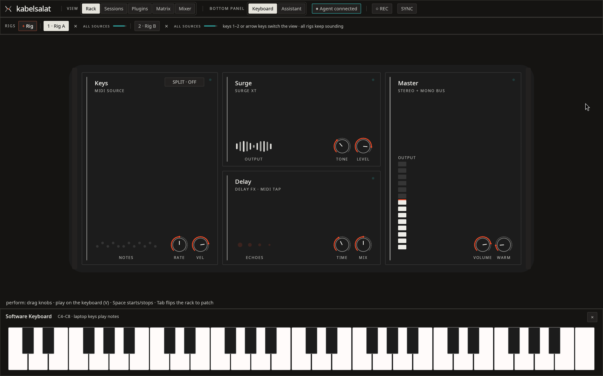</p>

**EXPAND** (**Shift+V**) turns the whole window into the instrument, without the
rack (Esc or DOCK brings it back), and the instrument moves as you play:

- **Piano:** the open case shows strings, dampers and hammers. A note's hammer
  rises and its string swings, and the dampers lift with the sustain pedal.
- **Jazz Organ:** a tone generator whose wheels light up for every pulled
  drawbar of the notes you hold, full-length drawbars with the registration
  written out ("88 8000 000"), preset keys, the rotary speaker spinning up and
  down, one or two manuals and the swell shoe.
- **Pipe Organ:** a pipe front where each sounding note's pipe speaks, every
  division's drawknobs at once, couplers, tremulants, thumb pistons, and swell
  shutters that open with the swell shoe.
- **Synth:** a display with the patch and a scope, the patch's macro knobs, a
  large X/Y pad, and full-height pitch and mod wheels.

<p align="center">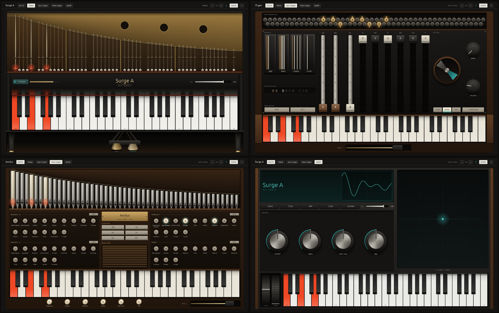</p>

- **E-Piano:** a tine per key that lights and swings while its note sounds,
  the tremolo wheel and the sustain pedal.
- **Bass:** a full neck to fifteen frets, with each held note on the string
  and fret a bassist would use.
- **Wind:** the breath column and an air column that shortens as the note
  rises and fills with the breath you give it.
- **Drums:** a kit seen from above, where you hit each drum and cymbal
  (harder in the middle), next to a 4×4 pad bank.

<p align="center">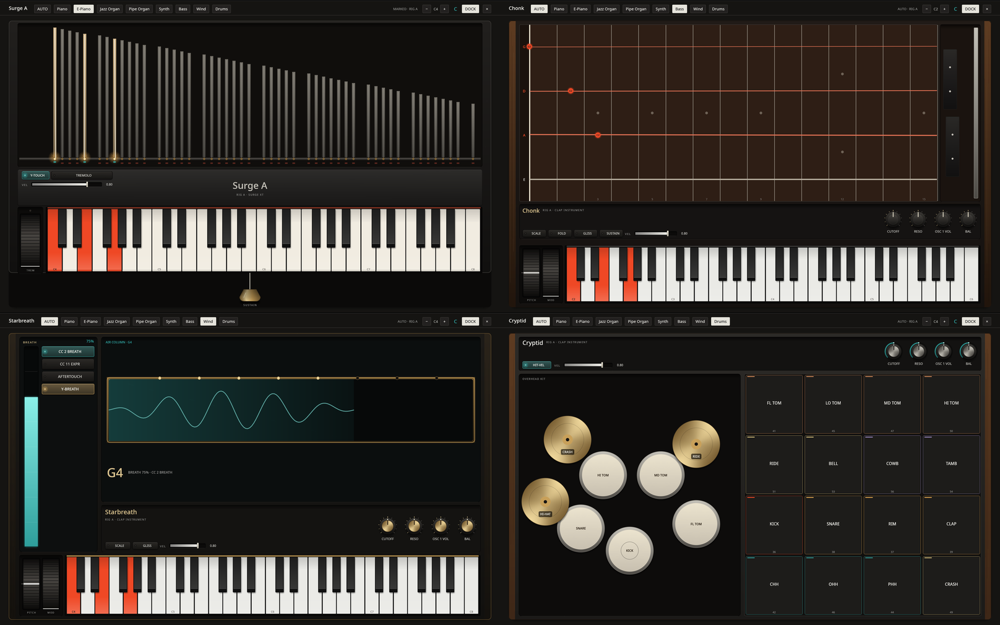</p>

### First start

On the very first start kabelsalat opens your sound output, plays one quiet
note and puts the keyboard up, with no dialog to answer; the laptop keys play
at once. If there is no synth plugin, the [factory sounds](#factory-sounds)
play. If something is wrong, one plain sentence appears for 25 seconds: no
output was found, the audio buffer is large (keys answer late), or the audio
thread has no realtime priority. Each sentence names the Audio Doctor
(Settings → Audio), which can fix the last two. A MIDI keyboard you plug in
later is announced the moment it appears. `kabelsalat first-run-test` runs a
scripted first start in an isolated home and fails if no sound comes within a
minute.

### Factory sounds

kabelsalat carries three instruments of its own: a **piano** (an upright), an
**electric piano** (FM) and a **drum kit** (synthesized hits on the General MIDI
notes the drum pads play). They play with no CLAP or LV2 plugin installed. When
Surge XT is not found at start, the starter rigs use the piano and the electric
piano in its place, so the first key press makes a sound. Add one to a rig like
any instrument (`add_node` with the plugin id `kabelsalat.factory.piano`,
`kabelsalat.factory.epiano` or `kabelsalat.factory.drums`); each has one sound
(`list_sounds`) and the sustain pedal works. The samples are reduced copies of
CC0 FreePats banks, rebuilt by `scripts/factory-sounds.sh`; their licences are
in `assets/factory/*/LICENSE`. `kabelsalat factory-test` checks the first note
of each without any plugin.

### Play your guitar

Plug a guitar (or a microphone) into your audio interface and press **⇧F5**: the
Guitar rig loads **Audio In → Scream → Delay → Reverb → Amp → Cabinet →
Master**. The Audio In unit picks any input by name, has a gain knob, a live
level meter, a **MON** switch for monitoring through the rig, and a built-in
**tuner** (note and cents) on its face. The stomps, amp and cabinet are the
Guitarix LV2 plugins from the Plugins browser (install the *Guitarix* card).
Monitoring goes through the same low-latency path as everything else; a missing
input says so instead of falling back to the laptop microphone.

<p align="center">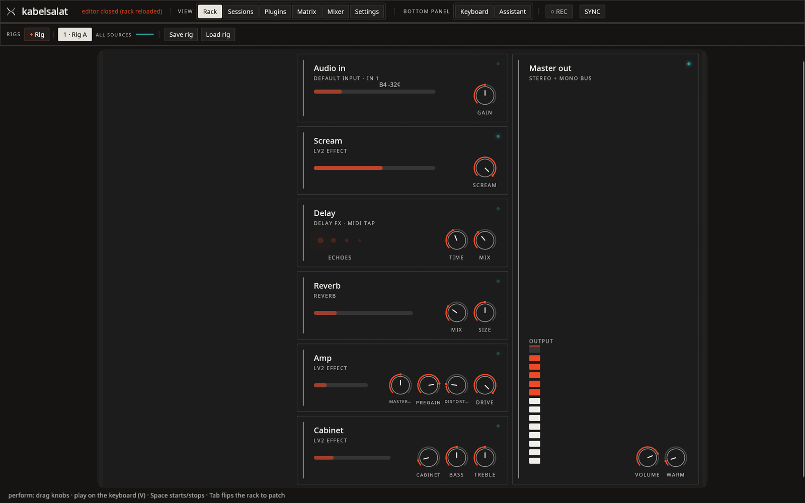</p>

## Build rigs

### Patch with real cables

Press **Tab** to turn the rack around and patch on the back. Drag from jack to
jack to connect, drag a plug to move it, pull it off to unplug. The cables
sag and swing, and light up when signal flows through them. Hover any jack to
trace its connected cables (dimming unrelated routes) and read a live port
tooltip with connections and signal level (dBFS for audio, active/recent notes
for MIDI). Right-click any cable or occupied jack to cycle its jacket color
within its family palette (warm for audio, cool for MIDI) or unplug every
cable on that jack. Dial **Cable opacity** and **Cable tension** from the
bottom-right controls on the back panel or under **Settings → Display** to tame
dense racks without losing cable physics.

Right-click any unit plate on the front or back to open its context menu:
**Bypass / Enable** (**Ctrl+E**), **Duplicate unit** (**Ctrl+D**, copying its
parameters and plugin state into the rig), **Initialize parameters**,
**Randomize parameters** (**Ctrl+R**, within sensible musical bounds as one
undo step), **Copy / Paste settings** between compatible units, **Unplug all
cables**, **Open plugin GUI**, or **Remove unit**. Bypassed units dim on both
front and back faces with a `BYPASSED` chip (click it to re-enable), stay in
sync with the mixer, release held notes safely, and keep delay compensation
intact. Agents and MCP clients have the same actions (`set_node_bypass`,
`duplicate_node`, `reset_node_params`, `randomize_node_params`).

Click the **padlock** button next to the view tabs (or press **Ctrl+L**) to **lock the rack for editing** once your patch is dialed in (saved with the session; agents/MCP: `set_rack_locked`). While locked, playing, transport, rig switching, setlist stepping, and flipping front/back to inspect cables all keep working, while patching, unplugging, reordering, adding or removing units and rigs, rack knob edits, and mutating agent calls are blocked.

<p align="center">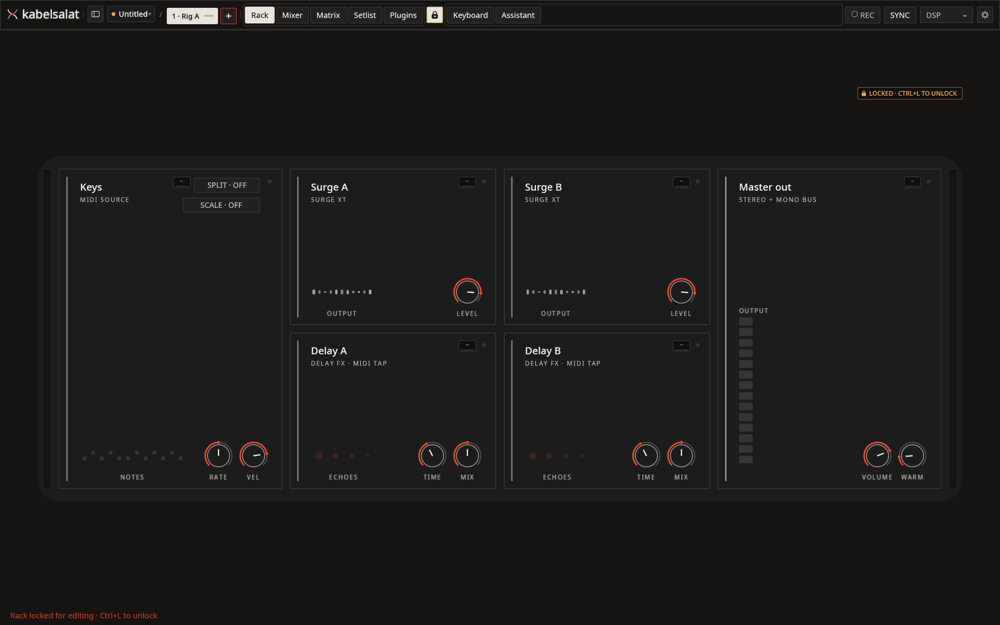</p>

<p align="center">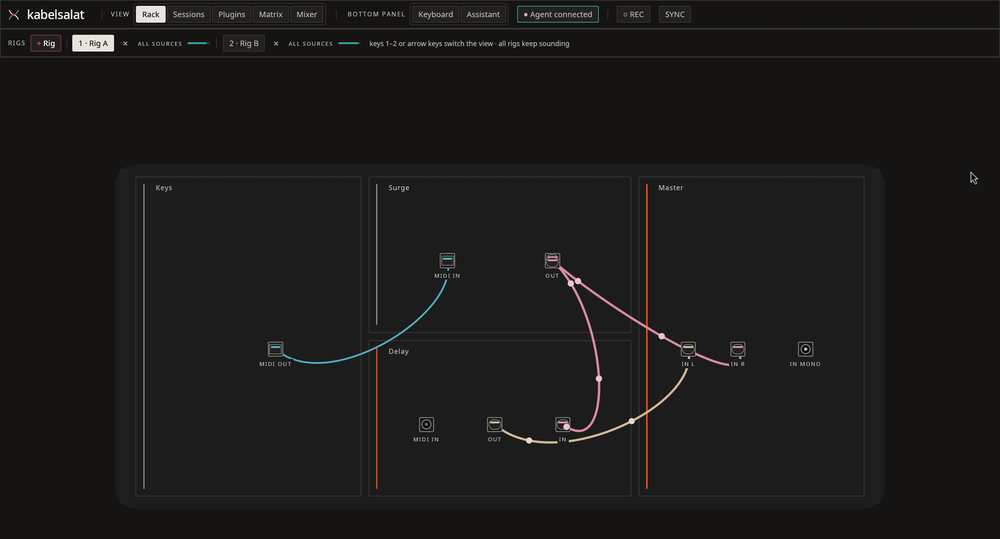</p>

### Zoom the rack

Zoom the rack to see all of a big rig or to tweak one unit, on the front and
on the back; knobs, jacks, cables and Ctrl-dragging a unit work at any zoom.

| Keys | What it does |
|---|---|
| **Ctrl+scroll** (or a trackpad pinch) | zoom about the pointer, 25 % to 300 % |
| **Ctrl+=** / **Ctrl+-** | step up / down: 25, 33, 50, 67, 80, 100, 125, 150, 200, 250, 300 % |
| **Ctrl+0** | back to 100 %; at 100 % a rack larger than the window zooms out until all of it shows |
| **Ctrl+Shift+F** | fill the view with the selected (or pointed-at) unit; again to zoom back |

The wheel pans a zoomed rack, and the hint line shows the zoom level while it
is not 100 %. **F4** (multi-rig demo) is unchanged.

### Run several rigs at once

**+ Rig** adds an independent setup with its own synth and output — for example
bass on one keyboard and pads on another. A session holds up to 32 rigs, enough
to keep every sound of a gig loaded. All rigs play together; switch the one you
are looking at with **1–9** or **← →**, or pick any rig from the Left Rail or
the top bar, which scroll when there are many. Any installed CLAP, VST3 or LV2 instrument works
(Surge XT, Dexed, Vitalium, …), and each unit shows which instrument and sound
it has loaded. Every rig row in the Left Rail (**Q**) has a **▶** demo button
that loops a live musical phrase suited to its sound (keys, bass, lead, pad,
organ, drums, or wind with CC 2 and aftertouch breath) on the engine clock at
the session tempo — turn knobs, swap sounds or add effects and hear them right
away without a MIDI keyboard (`play_demo` / `stop_demo` for agents).

### Route MIDI anywhere

The MIDI matrix decides which keyboard plays which rig. Each connection can be
shaped: only some keys (keyboard splits), another MIDI channel, transposed, or
only loud notes.

<p align="center">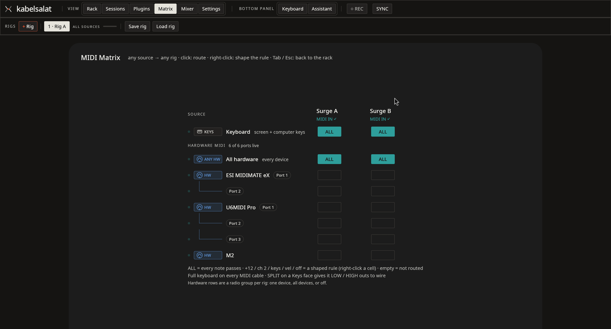</p>

### Put MIDI effects in front of an instrument

A **MIDI strip** sits between your keys and the instrument and changes the notes
on the way: the built-in **MIDI transpose**, or any installed LV2 MIDI plugin
(note transposers, filters, arpeggiators — pick one in **Plugins** and press
*Add MIDI strip*). The strip shows the plugin's own main controls, they can be
learned from a hardware knob like any other, and a note released while you turn
a knob never hangs. The assistant can add strips too (`list_midi_fx`, `add_node`
with kind `midi_fx`).

<p align="center">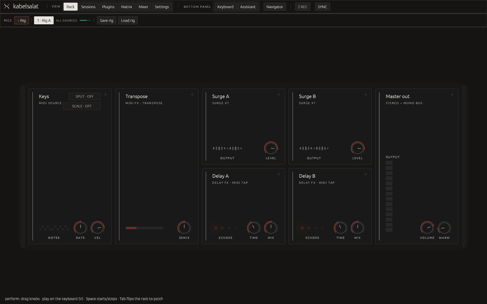</p>

### Switch, blend and split audio

Two built-in units in **Plugins → Mixer & routing** (*Add to rig*, then patch
them on the back with **Tab**), both with no latency:

- **Crossfader** has two stereo inputs, **IN A** and **IN B**, and one
  output. **MIX** goes from A (left) to B (right); **MODE** picks *power*
  (equal power, for two different sources), *linear* (for a dry and a wet path
  of the same sound) or *switch* (A below the middle, B above it). Learn MIX
  from a pedal, or put it in switch mode and learn a foot switch to flip
  between two amps or synths. Moves are smoothed over 5 ms, so a switch under
  a held chord does not click. Delay compensation lines the two inputs up when
  one of them runs through a latent unit.
- **Splitter** has one input and two outputs that add back up to the input.
  **MODE** picks *band* (OUT 1 low, OUT 2 high, split at **FREQ**, 60 Hz to
  8 kHz, 24 dB/octave Linkwitz-Riley), *M/S* (OUT 1 mid, OUT 2 side) or *L/R*
  (OUT 1 the left channel, OUT 2 the right). Put an effect on each output and
  cable both into the same unit to process the bands apart.

The assistant adds them with `add_node` (`dsp` = `crossfade` or `split`) and
wires the second input or output with `to_port` / `from_port` 1.

## Plugins

### Browse and install plugins by type

Press **F9** (or **B**) to open **Plugins**, organized by what each unit does
rather than by plugin format: **Instruments**, **Effects**, **MIDI FX**,
**Utilities** and the **Install** catalog. Narrow **Effects** by subcategory
(**Delay & Reverb**, **EQ & Filter**, **Dynamics**, **Drive & Amp**,
**Modulation**, **Pitch & Spatial**, **Multi-FX**) or filter by format
(**Built-in**, **CLAP**, **VST3**, **LV2**). Add an instrument as a **New rig** alongside
your existing rigs or layer it into the active rig, insert any effect onto the
active rig or straight onto the **Master FX** bus, and filter the mixer's
**+ insert** picker by the same effect categories. The assistant and MCP agents
search the same taxonomy with `list_plugins`.

<p align="center">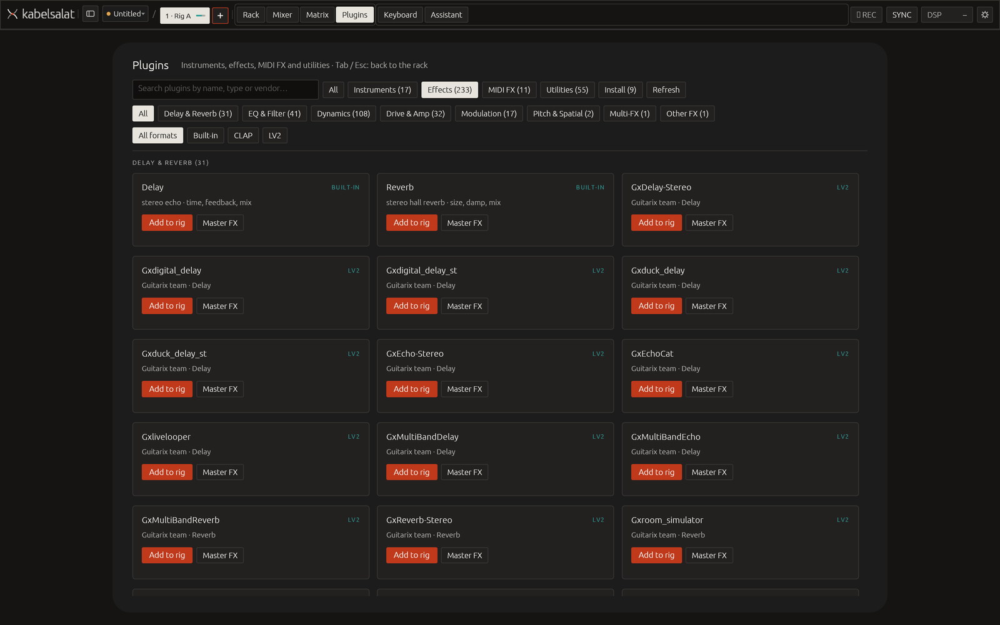</p>

### Search your own plugin folders

kabelsalat always searches the standard folders of each format (`~/.clap`,
`~/.vst3`, `~/.lv2`, and the same names under `/usr/lib` and
`/usr/local/lib`) and whatever `CLAP_PATH`, `VST3_PATH` and `LV2_PATH` name.
Plugins that live somewhere else, on a second drive or in a studio folder,
need no environment variable: open **Settings → Plugins** and use **Add
folder** under **CLAP folders**, **VST3 folders** or **LV2 folders**. Type the
folder (a full path, or one that starts with `~`) and press **Enter** or
**Save**. **Edit** points an entry at another folder, **Remove** takes it off
the list; nothing on disk is touched.

Every change rescans the installed plugins in the background, so playing goes
on and the **Plugins** view fills in when the scan is done; **Rescan** does the
same on request (after you copied a plugin into a folder). Custom folders are
searched after the standard ones. A folder that is not there right now, such
as an unplugged drive, is marked **not found** and stays on the list until you
remove it.

The folders are kept in `~/.config/kabelsalat/config.json` under
`plugin_dirs`, so sandboxed plugin workers, `kabelsalat mcp` and the
self-tests search them too. The assistant and MCP agents read and change the
same lists with `list_plugin_folders`, `add_plugin_folder` and
`remove_plugin_folder`.

<p align="center">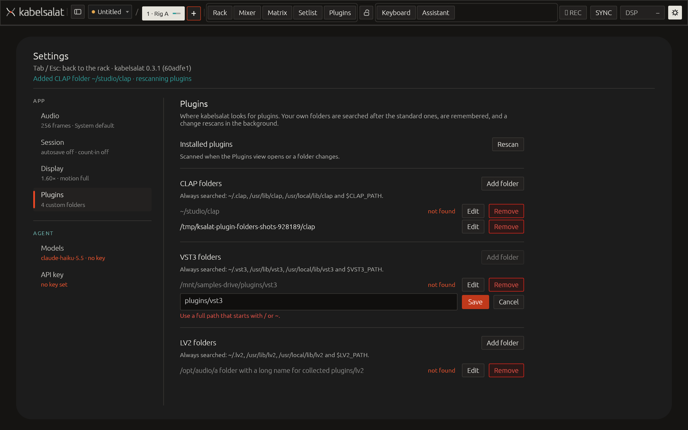</p>

### Favorites, recents and quick-add

Click the **☆** on any plugin card (built-in, CLAP, VST3 or LV2) to star it.
The **★ Favorites** chip then shows only your starred plugins, grouped by
type, and **Recent** shows the twelve you added to the rack last, newest
first. Both narrow whatever type is in view, so **Effects** + **★ Favorites**
is your short list of effects. Favorites and recents are kept in
`~/.config/kabelsalat/config.json` (`plugin_favorites`, `plugin_recents`) and
are there again after a restart.

On the rack, press **Enter** or right-click empty rack space to open
**quick-add**: a small picker over the rack that lists everything you can
add, with favorites first, then recents, then the rest. Type to search; the
search is fuzzy (`sxt` finds Surge XT, `rev` puts Reverb first) and also
matches vendor, category and format. **↑ ↓** choose a row, and:

| Key | Instrument | Effect or utility | MIDI FX |
|---|---|---|---|
| **Enter** or a click | layered into the rig in view | added to the rig in view | MIDI strip in front of the rig's instruments |
| **Shift+Enter** or Shift+click | a new rig | master insert | the same |

**Esc** or a click outside closes it. The chips narrow the list to
**★ Favorites**, **Recent** or one type. On a locked rack (Ctrl+L) quick-add
does not open and says why.

Agents star plugins with `set_plugin_favorite` and read both shelves with
`list_plugins` (`shelf: "favorites"` or `"recent"`); they add units with the
tools they always had (`add_node`, `add_insert`, `add_rig`).

### VST3 plugins and native plugin GUIs

kabelsalat discovers Linux-native and yabridge-bridged Windows `.vst3` plugins
in `~/.vst3`, `/usr/lib/vst3`, `/usr/local/lib/vst3`, `/usr/lib64/vst3`, and
`$VST3_PATH` (out of process via `kabelsalat scan-vst3`). Bridged Windows
plugins show a `VST3 · YABRIDGE` badge in the plugin browser. VST3 instruments
and effects run inside the same per-plugin shared-memory sandbox as CLAP and
LV2 plugins, save state into sessions, map MIDI CCs (`IMidiMapping`), and open
their native `IPlugView` X11 editor window.

Controls moved inside a native CLAP, VST3, or LV2 plugin GUI stay synchronized
live with Kabelsalat's parameter editor, pinned face/strip quick knobs, active
setlist part parameter cache, and learned MIDI CC feedback (and vice versa).
LV2 instruments, audio effects, and MIDI strips that ship a native
`ui:X11UI` or `ui:showInterface` editor also expose **Open plugin window** in
both the rack unit's right-click menu and the LV2 preset/parameter window. Note
that yabridge and native X11 plugin UIs run in XWayland windows on Linux; while
verified against C probe fixtures (`vst3-test`, `lv2-ui-test`), specific
third-party Windows/desktop bundles can be checked against your installed
plugins.

### Install instruments from the catalog

**Plugins → Install** lists 23 hand-picked plugins that are known to work in
kabelsalat, and **Install** fetches one for you: the Arch package where there is
one, otherwise a pinned release or a build from source into `~/.clap` or
`~/.lv2`. Synths: Surge XT, Dexed, Vitalium, Odin 2, OB-Xf (Oberheim), the
Juno-style Ultramaster KR-106, Six Sines (FM), JC303 (TB-303), YANES (chiptune)
and Cardinal (modular). Keys and organs: setBfree, Aeolus, Unsampled Piano
(physically modelled acoustic grand piano), OneTrick KEYS (lo-fi modelled
piano). Bass and drums: OneTrick CHONK, OneTrick CRYPTID (FM drums),
AVL Drumkits (sampled kits). Winds: Starbreath, modelled flutes, reeds and
brass for a wind controller (freeware, x86-64 only). Effects and MIDI tools:
Floe (sample libraries), Guitarix, Dragonfly Reverb (Hall, Room, Plate and Early
Reflections CLAP reverbs), Airwindows Consolidated (hundreds of Chris Johnson's
studio processors in one CLAP effect) and the x42 MIDI filters (chord, strum,
mono legato, CC remap). A card says when a plugin has no build for your CPU, and
links its source code and website. See [PLUGINS.md](PLUGINS.md) for
which plugins have been tested, what works, and what is still untested.

### Plugin crash isolation

Every hosted CLAP, VST3, and LV2 plugin runs in its own isolated
`kabelsalat plugin-worker` helper process, communicating with the audio engine
over an anonymous Linux shared-memory block (`memfd_create` + cross-process
futex) and a control socket for parameters, state, and X11 plugin editor
windows. If a plugin crashes (`SIGSEGV`, `SIGABRT`) or hangs past its per-block
deadline, the engine plays silence for that strip while every other rig keeps
sounding without an xrun. kabelsalat automatically restarts the dead helper
with the unit's last saved state (and live control port values for LV2) and
shows a `RESTARTED` badge on the strip so you know what happened.

Set `KABELSALAT_SANDBOX=0` to host CLAP, VST3, and LV2 plugins in-process
instead. Run `kabelsalat sandbox-test` to verify `SIGSEGV` recovery across
live rigs (CLAP and LV2) and measure the shared-memory IPC round-trip time at
64 and 256 frames.

## Mix

### Mix

Every source gets its own channel strip: a fader in dB with a 0 dB detent
(double-click for exact unity), a held peak and a clip light, plus pan, mute
and solo. Each strip lists the effects on its cable chain as insert slots —
add, bypass, reorder or remove them — and the master has inserts that run on
the whole mix before the limiter. Every source and insert slot has a quick
parameter knob beside it (defaulting to the plugin's first main control or an
effect's mix; right-click to reassign, double-click to reset). Rename a strip,
give it a colour, drag it to reorder or collapse it; names, colours and quick
knob assignments are saved with the session.

**Master to a loudness.** Beside Master out, the Loudness column takes a
target: −14 LUFS (Spotify, YouTube, Tidal), −16 (Apple Music), −8 (club), or
any value in 1 LU steps. Play your loudest passage first; picking a target
then trims the level in front of the master limiter by what is missing, and
the true peak is held under −1 dBTP. The column shows the loudness before,
the loudness now, the true peak and the trim. **Match** measures what you
played since and corrects the trim; if the limiter has no more to give, the
readout says so and asks for more master VOLUME. The target is saved with
the session. The assistant and MCP agents do the same with
`set_master_target` and read the numbers with `get_master_target`.

Parallel paths stay in phase. When a signal splits and meets again, and one
path runs through a unit that takes time (the Limiter waits 5 ms to catch
peaks, and a hosted plugin reports its own latency: a look-ahead compressor,
a linear-phase EQ), the other paths of that sound wait for it, so a dry sound
and its processed copy add up cleanly instead of sounding hollow. Only paths
that carry the same sound wait: a latent effect on the pad never makes the
piano beside it late. When a plugin changes its latency while you play (you
turn its look-ahead up), the paths are back in phase a moment later. A
bypassed unit keeps its delay, so switching it in and out never shifts
anything in time. A strip that sounds late says by how much, in milliseconds
under its fader: what its plugins report plus what keeping it in phase adds.

<p align="center">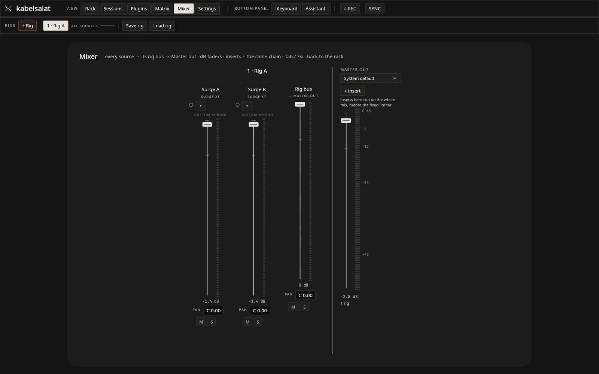</p>

### Share an effect with sends

**+ Aux bus** under the mixer's master strip adds a bus: a channel that nothing is cabled into.
Every rig bus and every source strip gets a **SENDS** row for it. Turn the
row's knob to send some of that signal to the bus (double-click: off or 0 dB)
and click **PRE** to tap it before the strip's fader, so the send keeps its
level when the fader moves. Put a reverb or a delay on the bus as an insert
and several rigs share it. The bus has its own fader, pan, mute and solo and
returns to the master past the rig faders; soloing it leaves only the returns.
Right-click a send knob to bind it to a hardware controller, like the faders.
Sends are saved with the session.

<p align="center">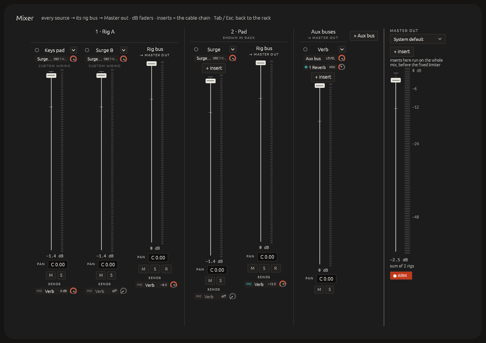</p>

### Mix the other apps and pick your sound card

Kabelsalat creates a native **PipeWire** audio node (`kabelsalat`) out of the
box — no `pipewire-alsa` bridge required — and you can switch audio backends
live under **Settings → Audio** (or with `KABELSALAT_AUDIO_BACKEND` /
`set_audio_backend`) between **Auto**, **PipeWire**, **JACK (`pipewire-jack`)**
(registers `Kabelsalat:out_1` and `out_2` for `qpwgraph` / `Helvum` / `qjackctl`),
and **ALSA** (with direct ALSA PCM device selection).

The backing track in your browser sits in the same mixer. Under **System
audio** every other app that is playing gets its own strip, named after the
app and what it plays, with a live meter, a volume fader and a mute button, so
you can turn YouTube down under your rig without leaving kabelsalat.
System-audio capture records those other apps' streams rather than the output
monitor, so mixing them into the master never feeds kabelsalat's own output
back, whichever sound card is chosen. At **Master out** a menu lists your sound
cards: pick your audio interface instead of the laptop speakers and the sound
moves there at once, without a dropout. The choice is remembered for the next
start, and **System default** hands the sound back to the system's output. The
assistant and MCP agents do the same (`list_app_streams`, `set_app_stream`,
`list_audio_outputs`, `set_audio_output`, `set_audio_backend`). System-audio
strips and live sink moves use PipeWire's Pulse layer (`pactl`, `parec`).

<p align="center">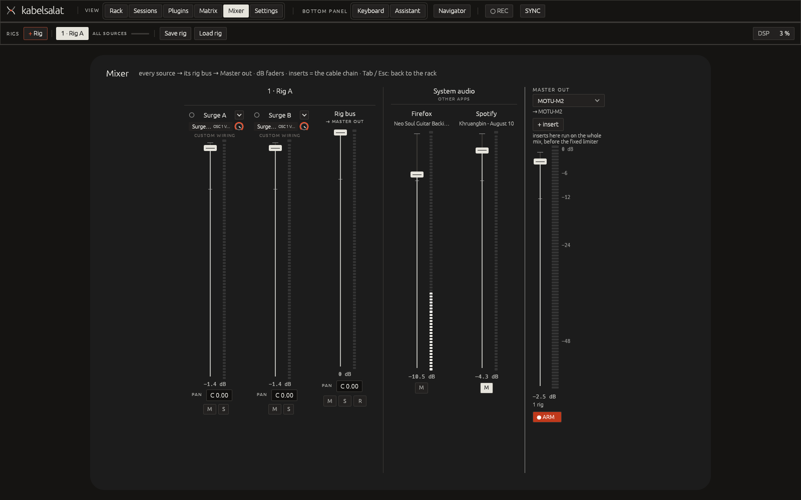</p>

### Send a bus to its own sound card

Every **rig bus** and every **aux bus** has an output menu under its name:
**Master out**, or one of your sound cards. A bus on its own card plays there
only and leaves the main mix. Put the metronome in a rig of its own and send
that rig's bus to the headphones, and the click never reaches the PA. For a
monitor mix, send your rigs pre-fader into an aux bus and give that bus the
headphones. The bus keeps its fader, pan, mute, solo and inserts. Up to four
cards besides the master's can play at once. The choice is saved with the
session. While its card is unplugged a bus is silent and its menu reads **not
available**; it never falls back to another output, and it plays again when
the card returns. A second card runs on its own clock, so a bus there can
arrive a few milliseconds apart from the master. The assistant and MCP agents
do the same (`set_bus_output`, `get_bus_outputs`). This needs PipeWire
(`pw-cat`, `pactl`).

<p align="center">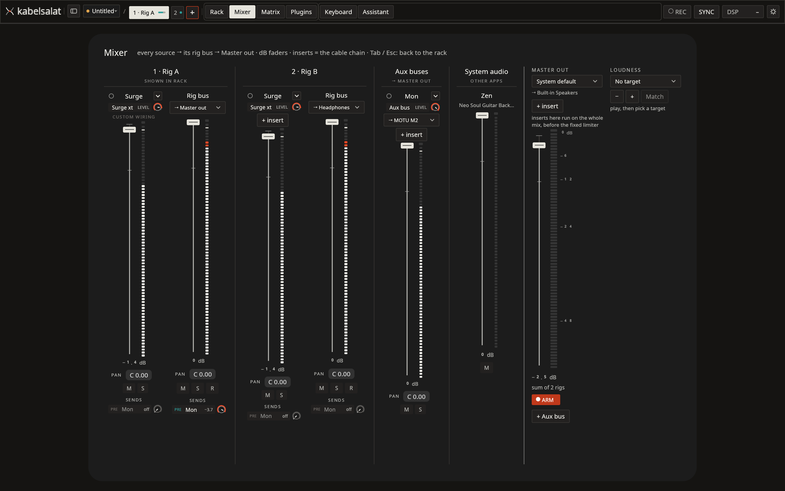</p>

### Stage outputs: FOH, in-ears and click on one interface

On an audio interface with more than two outputs, kabelsalat opens every one
of them (up to 32), and the Mixer shows **Stage outputs** under **Master
out**: where the **Master**, the **Click** (every metronome and the count-in)
and the **Track** (the backing track or cue file) play. Pick **Outputs 3–4**
for the click and the drummer's in-ears get it on 3–4 while Front of House
gets the master on 1–2 without it. Each assignment has its own level and
balance; a single output (**Output 5 (mono)**) sums left and right for a
wedge. The output menu of every rig bus and aux bus lists the interface's
outputs too, next to the other sound cards. A click, track or bus on outputs
of its own leaves the master mix and passes no master limiter (a soft knee
still keeps it below full scale). Outputs 1–2 belong to the master; move it
with its own menu.

The assignments are saved with the session. On an output with fewer channels
(rehearsing on a 2-channel laptop) they are kept: each source plays where it
would without one (the master on 1–2, the rest in the master mix), its menu
is outlined in amber, and the pre-show check warns, e.g. "The click is
assigned to outputs 3–4, but this output has 2 channels: it plays in the
master mix, so the audience hears it". Connect the stage interface and they
apply again. The assistant and MCP agents do the same (`set_output_route`,
`get_output_routes`). This needs the PipeWire backend; on JACK, route the
ports in the patchbay. `kabelsalat stage-out-test` checks it on two
temporary PipeWire null sinks (4 and 2 channels), so nothing is heard.

## Controllers and tempo

### Control knobs and the mixer from your controller

Drag any rack or mixer knob vertically; hold **Shift** while dragging for 10×
fine-tune control (holding **Ctrl** drags a unit to rearrange it), and
**double-click** any knob to reset it to its default. Hovering or dragging shows
real physical units (`Hz`, `ms`, `dB`, `%`, semitones, or the CLAP plugin's own
readout). Open a knob's right-click menu to type an exact value (`440 Hz`,
`250 ms`, `−6 dB`, `75%`, …) and press **Enter** — without getting in the way of
quick MIDI learn.

Right-click any knob, turn a knob on your MIDI controller — bound. The knob
shows its CC number and follows your hardware from then on.

The mixer learns the same way. Right-click a fader, a pan field, or a mute or
solo button on a source strip, a rig bus or the master, then move a fader or
press a button on your controller. A learned fader shows its CC beside the dB
readout, and every learned control gets a blue outline. Mute and solo follow
the button: on while it is latched (CC value 64 or more), off when it is
released. Right-click a learned control to limit a fader's range, learn it
again or clear it. The bindings are saved with the session and stay with their
rig when you add or delete rigs.

A whole hardware instrument maps in one step with an instrument profile. Pick
it for the instrument's port in the MIDI matrix (Nord Electro 2, Akai EWI 4000s
and Akai EWI 5000 are built in; more are MIDI Guide CSV files in
`~/.config/kabelsalat/instruments/`): the Nord's drawbars, rotary switch,
percussion and drive move the organ, while an EWI forwards CC 2 breath as
channel pressure alongside CC 2 so both breath-CC and aftertouch wind patches
respond (and the EWI 5000 is matched automatically by its USB port name). The
assistant and MCP agents do the same with `list_instrument_profiles` and
`set_device_instrument`: "the Nord is on the second port".

<p align="center">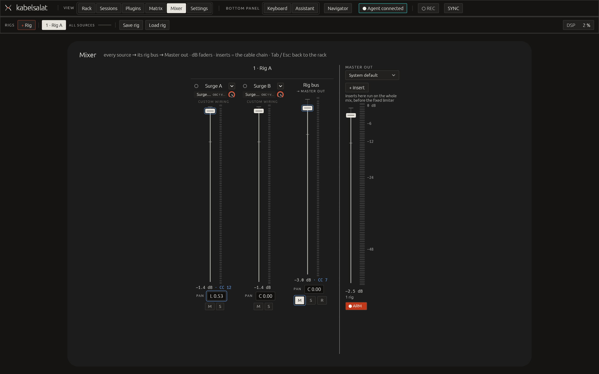</p>

### Count in any metre

The metronome follows the time signature you pick: beats per bar and the note
that counts as one, under **Settings → Session**, or the chip on the metronome
that steps through 4/4, 3/4, 6/8, 5/4, 7/8 and 2/4. The first beat of each bar
clicks higher, the count-in lasts whole bars, and recording and a synced backing
track start and stop on the bar lines of that signature. Plugins you host are
told it too, and it is saved with the session.

<p align="center">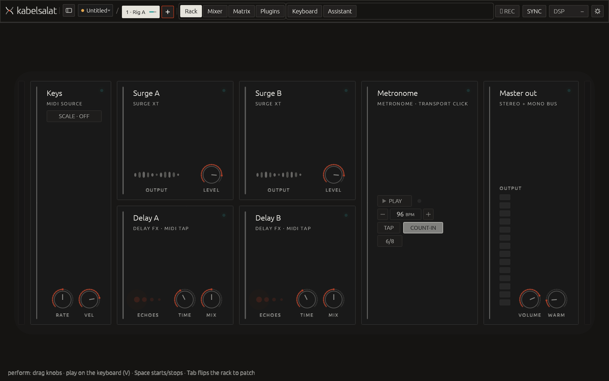</p>

### Be the clock

Switch on MIDI Clock Send in the matrix view and kabelsalat becomes the master
clock: 24 clocks per beat plus Start and Stop go to the MIDI outputs you wire
(drum machines, synths) and to a virtual port other apps can connect to. A sync
offset and three latency modes (none, output, input) line the clock up with what
you hear.

## Play live

### Play a setlist without a gap

Press **F12** or click **Setlist** in the top bar to organize a gig into songs and parts
(Verse, Chorus, Solo) over the loaded rigs. By default every rig stays loaded;
for long gigs on small machines (like a Raspberry Pi), turn on **Load ahead**
on the setlist to keep only the current song and the next few playable songs
(plus show-level rigs and active set-level rigs) hosted in memory. Upcoming
songs load in the background on dedicated CLAP and LV2 loader threads while you
play, outgoing rigs stay hosted until held notes and tails finish ringing out,
and the song list shows which songs are **Ready**, **Loading**, or **Unloaded**.
Jumping directly to an unloaded song announces that it is loading and loads it
in the background without blocking the audio thread (`set_setlist_window` for
agents and MCP; `kabelsalat setlist-window-test` measures memory scaling and
gapless in-order switching with real Surge XT). Each part
says which rigs take new notes, with per-rig key range, transpose, level, pan,
effect-chain bypasses and stored knob values (including pinned plugin knobs),
and each song can set its own tempo and time signature.
One hosted instrument can be shared across as many songs as you like (a piano in
twenty songs hosts one plugin instance, with each song's own level, pan, split,
effect chain and knobs applied at the switch without cutting held notes);
**Add song from session** shares matching hosted instruments (same plugin and
saved preset) automatically, while a different preset or **Own instance** hosts
a separate instance so switching never reloads plugin state mid-show. The
Setlist header shows how many instrument instances the show really hosts, and a
show-level rig has **Vary per song** to keep that one instance in every song
while customizing it per song.
Each rig also takes a velocity range and curve, so a soft pad can sit under a
hard-struck piano, and a floating split: its key range's edges follow the hand
that plays across them, by up to the set number of keys.
Switching parts never cuts held notes or reverb tails — outgoing rigs keep
sounding until you release the keys or sustain pedal, while new notes play the
next part from the same audio block on. Once an inactive non-live rig has rung
out below -100 dBFS (honouring CLAP `sleep` / `tail` hints and built-in
delay/compensation tails), it automatically enters allocation-free CPU sleep so
large multi-song shows only pay DSP cost for live rigs, waking in the exact
audio block a note, control, or part switch targets it. A part that moves a
rig's fader, pan, an instrument's level or an effect's bypass ramps it over
5 ms, so a chord held through the switch does not click.
`kabelsalat setlist-switch-test` measures a switch under a held chord with real
Surge XT voices (including switching between two songs that share one instance):
no gap, no click, the reverb and delay tails ring on, and the
first note of the next song starts in the block that switched (at most one
buffer later, 5.3 ms at the default 256 frames, plus the sound card's own
output latency). Step parts from the top bar, with
**PageUp / PageDown** (**Shift+PageUp / Shift+PageDown** for songs — works with
page-turner pedals), or from a pedal or button you learned (see "Run the show
from a pedal"). Under **Program change picks the song**, turn a keyboard or
foot controller on, and its preset buttons pick songs: program change N jumps
to song N+1 in the next audio block, and that device's program changes no
longer reach its instruments (other devices' still do). **Add song from
session** pulls a saved session into the gig as a new song (reusing matching
hosted instruments by default), and the
assistant and MCP agents can read, build and step the setlist.

<p align="center">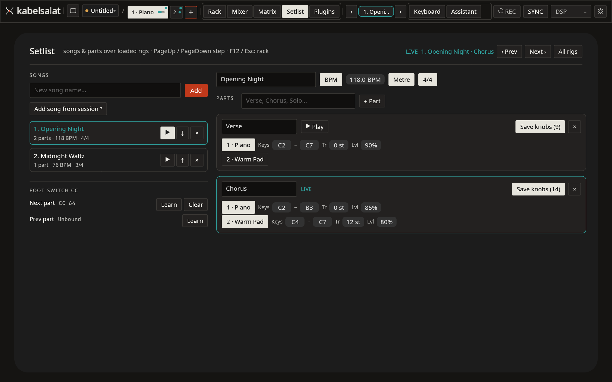</p>

### Keep what stays through the whole show

A vocal mic, a guitar input FX rig, a master reverb or a volume pedal is set up
once and stays through every song. Each rig, aux bus and MIDI controller binding
lives at **show** level (no song switch touches it: it keeps the whole keyboard,
its fader and its knobs — or turn on **Vary per song** on a show-level rig to
keep one persistent input chain while changing per-song bypasses and knobs), at
the level of a **set** (a named group of songs) or at **song** level (only where
the setlist's parts use it). A rig or bus a part uses is at
song level by itself; everything else is at show level, which is also how
older sessions load. Group songs into sets under **Setlist → Sets & levels**,
move a set or skip it as a whole, and choose each level there or on the
mixer's bus strips. Agents read and set them with `get_setlist`, `set_level`
and `set_setlist_set`.

<p align="center">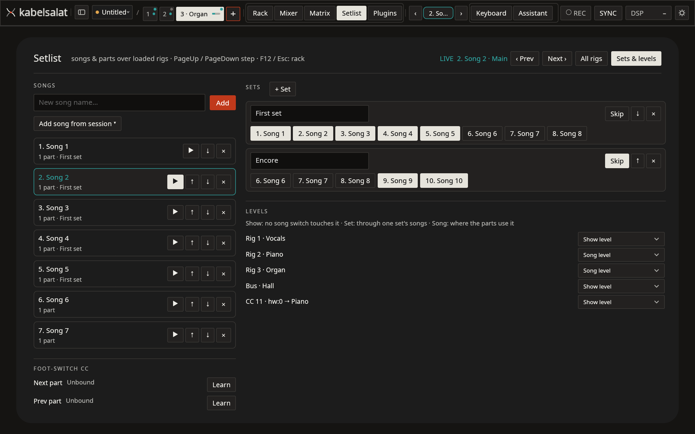</p>

### Give each part its own send effects

A singer or guitarist keeps one input rig running through the whole show
(show level, above) and wants a dry verse, a hall reverb on the chorus and an
echo on the solo. Aux buses (see "Share an effect with sends") hold those
effects; a part's **send scene** holds how much of the rig goes into each.

In the Setlist, **Save sends** on a part stores what the Mixer shows now: every
open send level, plus the bypass and knobs of the effects in the aux buses'
chains. The button then reads the scene ("Sends: Hall 50 %"); click it again to
store the Mixer anew, **Clear sends** removes it. A switch to the part sets all
of it, also for a rig at show level, whose fader and effects are otherwise
never touched. Each send level ramps over 5 ms and the buses keep running with
nothing new sent in, so there is no click and the last part's reverb or echo
tail rings out. A scene is a full picture: a send another part's scene names
and this one does not is closed on the switch; a part without a scene leaves
the sends alone.

**Shift+F8** (or `load_template` `stage_sends`) loads **Stage Sends**: Audio In →
Tone → Limiter → Master at show level, Hall and Echo buses, and a song with
Verse, Chorus and Solo that each carry a scene. Pick the input on the Audio In
unit's face. Agents and MCP use `set_part_sends` (set, merge, `capture` or
`clear` a part's scene) and see each part's `scene` in `get_setlist`.
`kabelsalat levels-test` plays the template under a held tone and checks that
every send lands on its level, that nothing clicks (second difference of the
held sine) and that the echo's tail rings on.

### Go on stage with Show mode

Press **F2** or click **Show mode** in the Setlist header (agents: `set_show_mode`) for a
full-window stage screen you can read from two metres away: the current song
and part in large type, the upcoming part and next song, top status pills (`REC`,
`TRACK`, `CLICK`), tempo and time signature, the master
meter, one meter per rig that plays in this part, and a clock. Editing is
locked while it is open: no click or key moves a cable, a fader or a song.
PageUp / PageDown (Shift for songs) and a foot switch still step the setlist,
**Panic** sends all notes off on every rig (agents: `panic`), and to leave
you hold **Esc** until its line fills (a second), then let go.

<p align="center">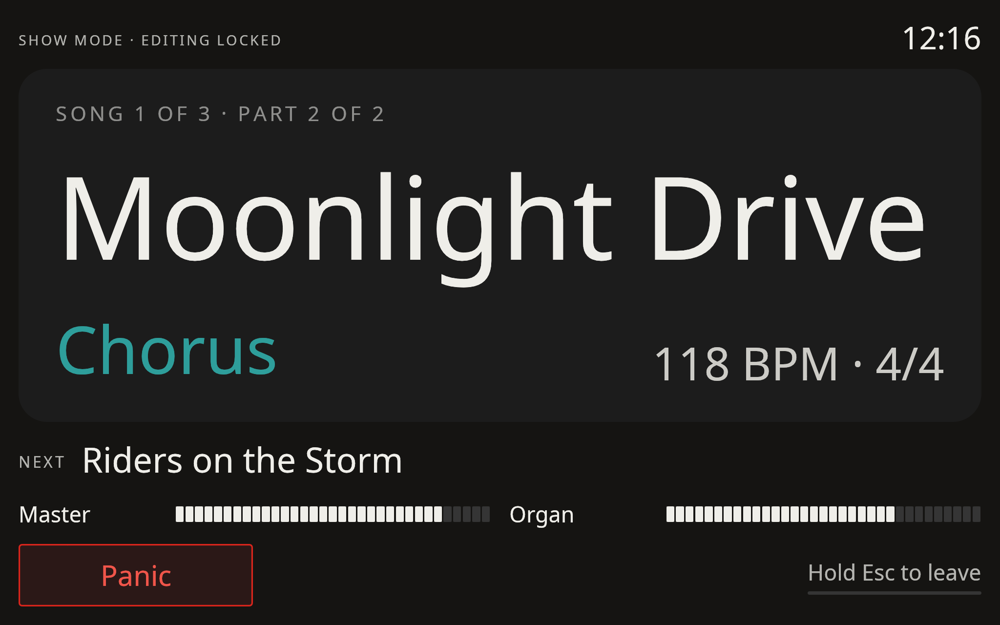</p>

### Song notes and chord charts

Each song in the Setlist editor has a collapsible **Notes / Chords** field for
cues, lyrics, reminders, or [ChordPro](https://www.chordpro.org/) lead sheets
(`[Am]` chord brackets, `{title:...}`, `{c:...}` / `{comment:...}` section
headers). When a song has notes, **Show mode** (**F2**) displays them in a
clean scrollable panel alongside the stage readout without crowding the
two-metre-readable song and part title: ChordPro chords are highlighted above or
inline with the lyrics and `{comment:...}` lines render as section headers,
while plain text renders cleanly as written. Notes are saved inside the session
file (and omitted when empty so existing sessions stay compatible).

### Check the show before the first song

**Setlist → Check show** finds what could go wrong while there is still time to
fix it, and changes nothing: every MIDI device the show binds is plugged in,
the chosen output and every Audio In device are connected, every plugin is
installed and loads, every rig makes sound (each plays its demo phrase in an
offline engine of its own), every song's backing track is on disk, there is
room to record, the buffer has headroom, and the laptop runs on mains power.
Each check says ok, warning or problem, what to do about it, and offers a
one-click quick-fix button (`Matrix →`, `Mixer →`, `Install →`, `Rack →`,
`Settings →`, `Fix track →`) right on failing rows. Agents get the
same list from the `preshow_check` tool, and `kabelsalat preshow-check
<session.ksalat>` prints it in a terminal (exit status 1 on a problem).

<p align="center">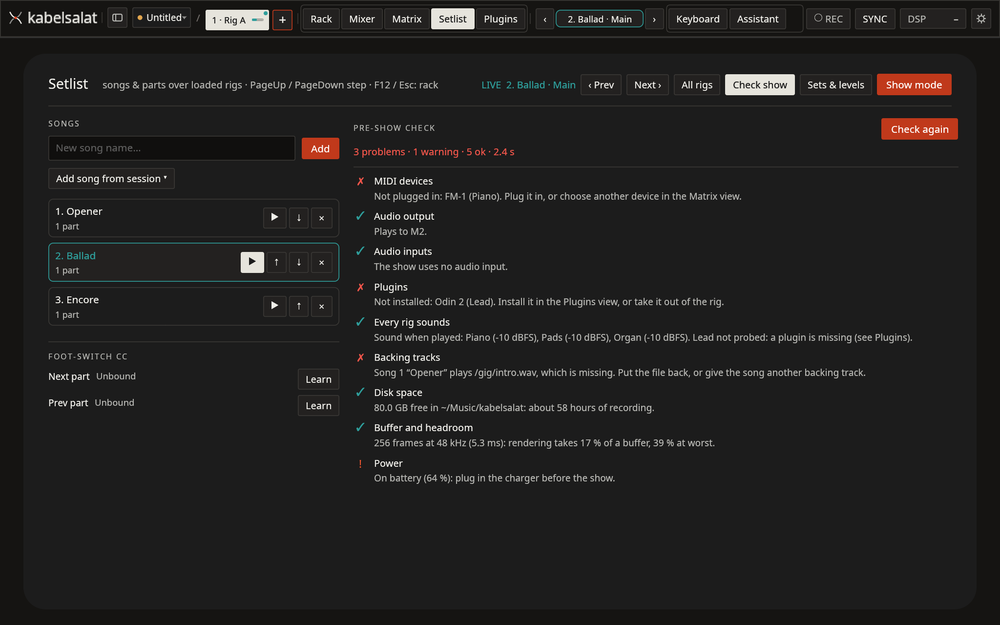</p>

### Run the show from a pedal

Every show action has a row under **Setlist → Show controls**: next and
previous song, next and previous part, Panic, tap tempo, tuner on/off, master
mute, start/stop the backing track and start/stop recording. Click **Learn**
and press a foot switch, a pad, a key or a preset button: a CC, a note or a
program change from that device is learned, like a knob's MIDI learn. From
then on its press does the action in the next audio block (the tuner and
recording a frame later), in every song and in Show mode, and it never reaches
an instrument; a key held while it is learned still gets its release. One
message does one action: learning it for another moves it there. The devices
whose program change picks the song are rows of the same list. Press **Ctrl+T**
or click **TUNE** on Audio In to toggle the tuner; it shows
the note the first Audio In plays and how many cents it is off; click it to
close it. Agents list and set the controls with `get_show_controls` and
`set_show_control`.

<p align="center">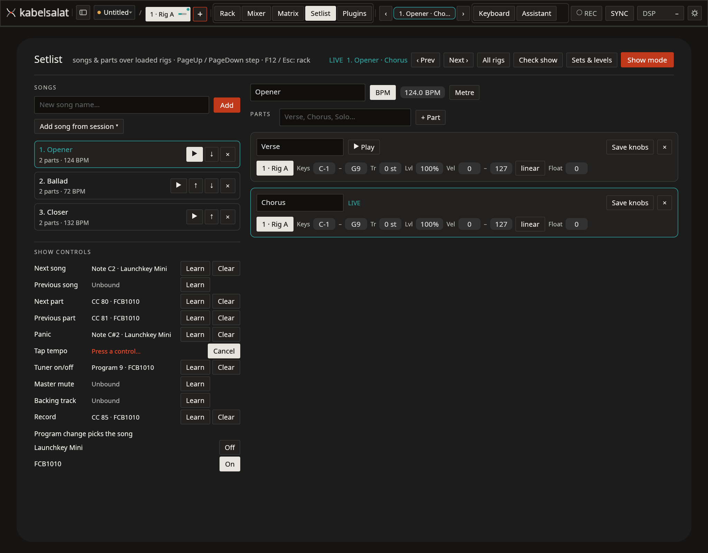</p>

<p align="center">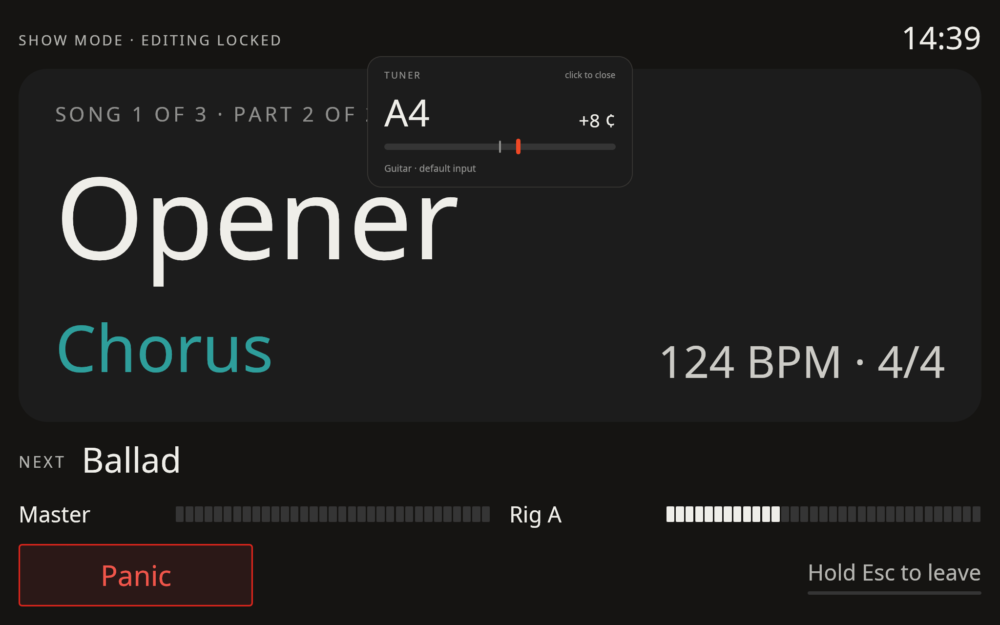</p>

### Play along with a backing track

Ask the assistant (or an MCP agent) to play a WAV file and it mixes into the
master like AUM's FilePlayer: **loop** restarts it seamlessly, **sync** plays it
at the transport tempo from its original BPM (a "120 bpm" in the file name is
picked up; speed changes, pitch follows, no time-stretch), **beats** sets the loop
length in beats so an aligned loop never drifts off the metronome, and **offset**
shifts the start. With sync on and the transport rolling, it starts on the next
bar line. Attach a WAV file directly in the Setlist song editor (**Pick WAV…**
or drop a `.wav` file onto the app), or name one via `set_setlist_song` with
`backing`: selecting the song starts it, a song's backing track stops cleanly at
the end of the song rather than looping unexpectedly (unless **loop** is
explicitly enabled), and switching to a song without one stops playback.

### Markers: jump to a section, loop a section

A song's backing track can carry **markers**: named points that cut it into
sections. The WAV's own cue points (with their labels) become markers when the
track first loads; under **Markers** in the Setlist song editor you add more
(**+ Marker** puts one at the spot you clicked on the waveform, or at the
playhead), rename, remove or move them, and each marker can pick a **part** of
the song: when playback reaches or jumps to the marker the sound switches to
that part, in the engine, like a foot-switch step.

The actions work on the section playing:

| Action | What it does |
|---|---|
| **Go** / `jump` | jump to that marker |
| **Next ▸** / **◂ Prev** | the marker after / before the section playing |
| **Loop** | repeat the section playing until switched off (no gap, no click) |
| **Stop at end** | play to the end of the section, stop once; the next start goes on from the next section |

With **sync** on and the transport rolling, a jump waits for the next bar line
and the marker lands on it (a section of whole bars stays on the bar through
its loop). Without sync, or with the transport stopped, it goes at once or
sets where the next start begins. Every seam is a 5 ms crossfade.

Learn the four actions on pedals like the other show controls (**Setlist →
Show controls**: Next marker, Previous marker, Loop section, Stop at section
end). The assistant and MCP agents use the `backing_markers` tool. Markers are
saved with the song. In Show mode the waveform, its markers, the playhead and
the section name sit under the song title.

### Running backing tracks for a band

Bands moving from custom DAW scripts (such as Ardour setlist scripts) can run a
full backing-track show from one session:

- **Reorder and group sets:** arrange songs in **Setlist** (**F12**) and group
  them into sets under **Setlist → Sets & levels**; skip a set or adjust song
  order between soundcheck and stage without re-exporting audio.
- **Keep the click out of the PA:** put the **Metronome** in its own rig and
  route that rig's bus to a dedicated headphone/IEM output in the mixer (see
  [Send a bus to its own sound card](#send-a-bus-to-its-own-sound-card)), while
  backing tracks and instruments go to **Master out**.
- **Step hands-free:** bind a MIDI foot switch or page-turner pedal under
  **Setlist → Show controls** to step songs/parts and start or stop the backing
  track.
- **Read it from across the stage:** switch to **Show mode** (**F2**) for
  two-metre-readable song titles, next-song preview, optional song notes/chord
  charts, live meters, and editing lock.

### Record your set

**REC** records exactly what you hear into a WAV file in `~/Music/kabelsalat/`.
After stopping you can play the take back or open its folder; **SYNC** starts
and stops the recording with the transport. For stems, press **R** on a rig's
bus strip in the mixer: every armed rig records its own post-fader WAV, named
after the rig, into the same take folder as the master mix (**ARM** under
Master out). Pressed while the transport rolls, REC starts and stops on the
next bar; stopping the transport keeps recording so reverb tails are not cut.

Forgot to press REC? kabelsalat keeps the last two minutes of the master and
of every armed rig in memory. Right-click **REC** and choose **Save the last
2:00**: it becomes a take folder like any recording, so the take you did not
plan is not lost. Settings → Audio → **Keep the last** sets how far back (1 to
10 minutes, or off); machines with under 3 GB of memory start with it off.
The assistant and MCP agents save it with `record_save_last`.

### Get back on stage after a crash

If kabelsalat crashes, it starts again by itself and reopens the session and
the setlist part you were on, so the next song is seconds away. It writes a crash report to
`~/.local/state/kabelsalat/crashes/` (under `$XDG_STATE_HOME` when that is
set): the version, what went wrong, the
plugins loaded and the last engine commands, and no folder or file names of
yours. Nothing is sent anywhere; the restarted app offers to open the folder
or a GitHub issue with the report filled in, which you send yourself. Set
`KABELSALAT_WATCHDOG=0` to run without the restart.

### Unplug and replug mid-show

A bumped USB cable never needs a restart:

- **Audio output.** When the stream stops (interface unplugged, PipeWire or
  JACK restarted, or no audio callback for 2 s), kabelsalat closes it and opens
  it again, on the same backend and output with the same sample rate and buffer
  size, about every 2 s until it plays. With PipeWire the output you picked
  comes back too once it is listed again. If the device returns with another
  buffer size or sample rate, the notice and the audio settings say so.
- **JACK routing.** If another client disconnects both of kabelsalat's output
  ports, they are connected back to the playback ports they had. One
  remaining connection counts as your own routing and is left alone.
- **MIDI controllers and foot switches.** An unplugged device keeps its place,
  so its rig binding, learned CCs and setlist foot switch come back with it,
  also under a new ALSA client number. Keys and the sustain pedal it was
  holding are released at once, so nothing drones on.
- **Audio inputs.** An input whose device went away opens again once the
  device is listed again. Until then it stays silent and never takes over
  another input.

Each event shows a notice at the top of the stage for a few seconds. In Show
mode an indicator says `NO AUDIO OUT · reconnecting` for as long as the output
is down, and `AUDIO BACK`, `MIDI LOST` or `MIDI BACK` for a few seconds after
an event.

## Engine and audio

### Keep an eye on the engine

Beside your rigs, **DSP** shows how much of each audio buffer the engine needs
to render your rack. It turns amber from 70 % and red above 90 %, and counts
the dropouts (xruns) the sound card reported. Click it for **Engine info**:
sample rate and buffer, inputs and outputs, late blocks and xruns, the
latencies kabelsalat measures, and the render time of every instrument and
effect, most expensive first, so you see which unit to swap when the load
climbs. Press **F3** (or toggle **Rack CPU · F3** in Engine info) to paint a
live CPU meter directly on every unit of the rack — front and back — with a
hairline micro-bar and its share of the audio buffer budget (cream normal,
amber above 15 %, red above 30 %). Adjust the audio **Buffer size** (64–2048 frames, default 256) live
with **− / +** in Engine info or from **Settings → Audio** — smaller lowers latency,
larger prevents xruns — and the choice is remembered across restarts. The
assistant and MCP agents read and adjust the same engine settings
(`get_engine_info`, `set_buffer_size`).

### Diagnose latency and xruns with Audio Doctor

Under **Settings → Audio**, **Audio Doctor** checks the Linux settings that
most often cause crackles or unexpected delay: PipeWire's active quantum and
sample rate compared with kabelsalat's buffer, realtime audio priority
(`rtkit` / `RLIMIT_RTPRIO` and whether the live render thread runs realtime),
the CPU frequency governor (`powersave` / `powerprofilesctl`), USB audio
autosuspend (`auto` vs `on`), and current buffer load / xruns. Every finding
comes in plain language with a non-blocking **Fix** button (or the exact
one-line command when administrator permission is needed). You can also run a
guided **Round-trip latency** measurement (via a loopback cable or speakers
and microphone) and a cancellable 60-second **Live xrun check** that plays a
test rig and explains the likely cause of any late buffers. Whenever
**Setlist → Check show** flags a buffer or audio warning, **Open Audio Doctor**
jumps straight here. Agents can run the same read-only diagnostic with the
`audio_doctor` tool, and `kabelsalat audio-doctor [--json]` prints it in a
terminal.

<p align="center">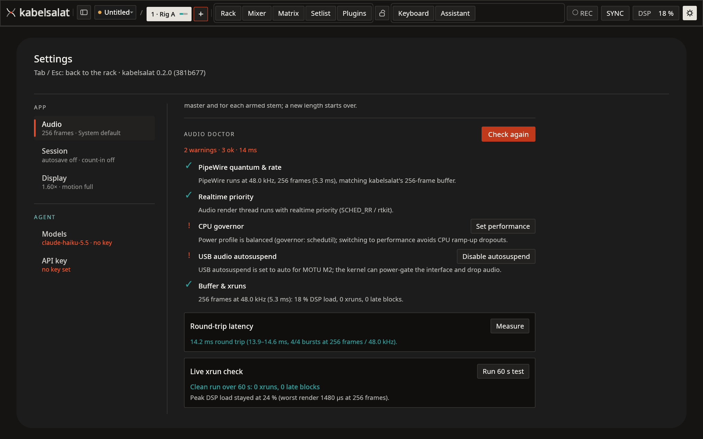</p>

### Raspberry Pi and headless rigs (ARM64)

Every release ships a native ARM64 AppImage (`kabelsalat-aarch64.AppImage`) for
Raspberry Pi 4/5, Asahi Linux, and other ARM64 Linux boards:

```sh
curl -LO https://github.com/ssalentin/kabelsalat/releases/latest/download/kabelsalat-aarch64.AppImage
chmod +x kabelsalat-aarch64.AppImage
./kabelsalat-aarch64.AppImage
```

For compact sound modules, battery-powered rigs, or headless setups without a
monitor:

- **Headless and remote control:** run `kabelsalat mcp` for a headless engine
  driven over MCP, or `kabelsalat mcp --attach` / `kabelsalat send '<json>'` to
  control a running instance from a script or SSH session. You can also check a
  show or audio setup over SSH with `kabelsalat preshow-check <session.ksalat>`
  and `kabelsalat audio-doctor --json`.
- **Save RAM on long setlists:** enable **Load ahead** in **Setlist** so only
  the current song, show/set-level rigs, and the next few upcoming songs stay
  hosted in memory while the rest load in the background. On machines with under
  3 GB of RAM, retrospective recording (**Keep the last**) starts disabled
  automatically.
- **Keep CPU and power predictable:** inactive rigs automatically sleep once
  their tails drop below −100 dBFS, so large multi-song sessions only pay DSP
  cost for active rigs. Run `kabelsalat audio-doctor` to check realtime
  priority, the CPU frequency governor (`performance` instead of `powersave`),
  and USB autosuspend for your audio interface and MIDI controllers; start with
  a 256-frame buffer (5.3 ms at 48 kHz) and raise it to 512 if xruns appear.

## The assistant and AI agents

### Ask the assistant — or your own AI agent

Press **C** to open the built-in assistant (**F12** opens the Setlist; **Shift+R**
resets the selected unit's or active rig's knobs on the rack). Bring your own
[OpenRouter](https://openrouter.ai/keys)
key (entered directly in the dock or under **Settings → Agent → API key**) and
it can set things up for you:
"add a reverb to this rig", "split the keys at C4", "load a warm pad". One key
reaches every model: **Settings → Agent → Models** picks the chat model, the
decisions model and the listening model, or takes any OpenRouter model id. While
it works, the assistant says what it is doing ("Planning the next step · after
Load sound"), and when it listens to your sound a bar shows how long it still
records, in the dock, on the top bar's button and on the rack's hint line.
Don't want it? Switch **Assistant** off on the same page (or click **Hide Assistant**)
and it leaves the top bar and the dock. Everything an agent changes lights up in
the rack, and **Ctrl+Z** undoes both agent turns and manual rack, setlist,
template and mixer edits in one step. External AI agents (Claude, …) can drive the running app through
the built-in MCP server; the top bar shows when one is connected and pauses it
with one click.

<p align="center">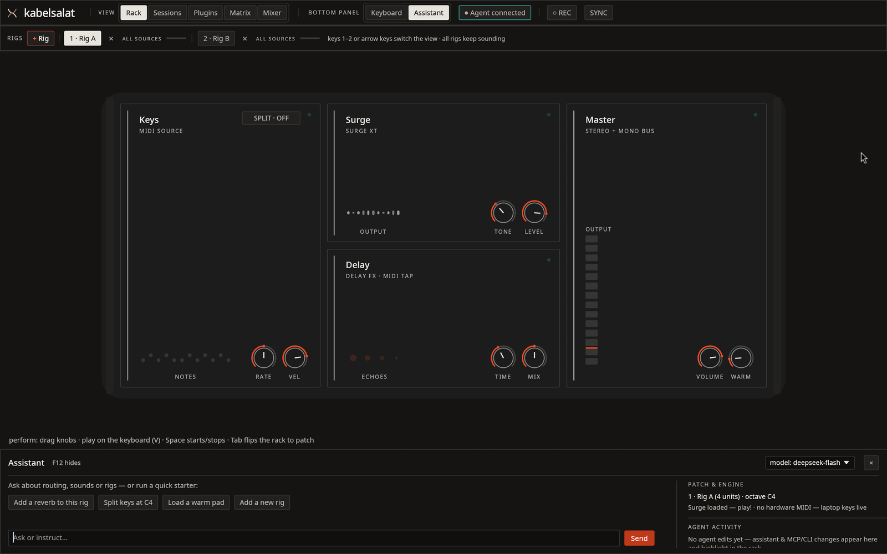</p>
